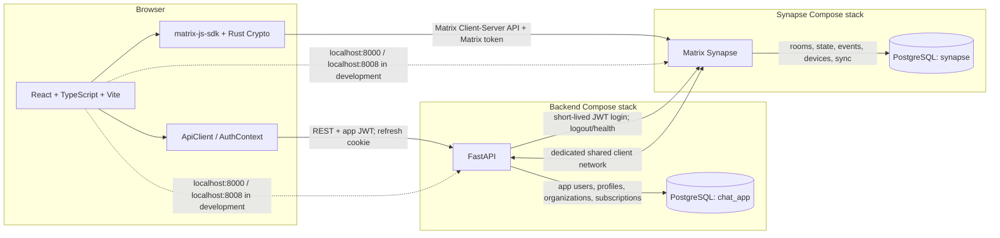

# LumaChat — Senior Developer Interview Questions and Answers

**Audit basis:** source and configuration in this checkout, reviewed 2026-10-27. `HEAD` is `b8e0fda` (`main`, also `origin/main`). That commit contains the Step 07 E2EE implementation and test assets, although its subject is “chore: add AI development guidelines.” The working tree also contains uncommitted Step 08 work; see Q5 and Q11.

**Verification recorded for this guide:** `npm test` passed 6 frontend test files / 33 tests, and `npm run typecheck` passed on 2026-10-27. The backend suite was not run: its fixture drops and recreates `chat_app_test`. Browser, live Synapse/E2EE, and load tests were not run. Existing E2EE test scripts and documentation are described as test harnesses and assertions, not as fresh successful live results.

**Status labels:** VERIFIED means a relevant check was run in this review or direct test evidence is cited as having been run. IMPLEMENTED BUT NOT LIVE-VERIFIED means source exists but the service/browser integration was not exercised here. PARTIAL means some path exists but an important capability is absent or blocked. PLANNED means documentation/configuration is only a proposal. NOT CONFIRMED means the repository cannot establish the claim.

No credentials, tokens, signing keys, or private-key values are reproduced here. The local `synapse/config/homeserver.yaml` is ignored by Git; treat it as sensitive local runtime configuration.

## Part 1 — Project overview

### Q1. What is LumaChat, and what problem does it solve?

**Short interview answer (30–45 seconds):**

I built LumaChat as a secure messaging prototype that could sit alongside a recruitment SaaS product. It gives logged-in users a profile and an organization-scoped directory, then uses Matrix for conversations and encrypted text instead of storing chat history in the recruitment API. The code is a chat foundation, not a completed ATS integration: it has no candidate, vacancy, interview, or recruiting-workflow model yet.

**Technical explanation:**

The frontend has login/register pages, a demo preview, live Matrix rooms, a directory-driven “start conversation” flow, message rendering, and an encryption/device dialog. FastAPI owns application identities, profiles, organizations, subscriptions and directory visibility. Synapse owns Matrix accounts/devices, room membership/state, event timelines and sync. In this codebase “recruitment SaaS” is the intended product context; the actual integration boundary is currently an application user directory rather than candidate/job records.

**Evidence in my project:**

- `backend/app/models/user.py:21-83`, `backend/app/models/profile.py:12-39`
- `backend/app/api/v1/users.py:17-78`, `frontend/src/components/chat/NewConversationDialog.tsx:29-99`
- `frontend/src/pages/ChatPage.tsx:37-524`, `docs/architecture.md:1-12`

**Possible follow-up question:** Which recruitment objects can a recruiter message today?

**Answer:** None are represented as domain objects here. A user can discover an authorized application user and open a Matrix room; candidate and job associations would need to be added.

**Implementation status:** PARTIAL — chat and directory foundation exists; recruiting-domain integration is not present.

### Q2. Explain the overall system architecture.

**Short interview answer (30–45 seconds):**

The browser has two separate communication paths. It calls FastAPI with the application JWT for login, profiles and directory access, and it calls Synapse directly with a Matrix access token for rooms, sync and messages. FastAPI has its own PostgreSQL database; Synapse has a separate PostgreSQL database. Docker Compose defines the backend and Synapse stacks and their private networks, while the Vite frontend runs separately in development.

**Technical explanation:**

FastAPI performs the app-password login and exchanges a short-lived signed assertion with Synapse. Synapse returns a Matrix session to the browser. The browser’s Matrix SDK initializes Rust Crypto, synchronizes rooms and sends/receives Matrix events. FastAPI does not proxy message bodies. The backend joins a dedicated client network to call Synapse; each PostgreSQL service stays on its own internal network and its port is not published. The browser uses loopback-published API ports in local development.



The diagram’s final two dashed arrows represent separate browser requests to the two host-published APIs; they do not imply that the browser uses the Docker-only hostname `synapse`.

**Evidence in my project:**

- `backend/app/main.py:15-38`, `backend/app/api/v1/router.py:6-12`
- `compose.backend.yaml:1-113`, `compose.synapse.yaml:1-101`
- `backend/app/core/database.py:9-26`, `backend/app/integrations/matrix/client.py:24-115`
- `frontend/src/services/matrix/client.ts:99-158`, `docs/api-boundaries.md:1-22`

**Possible follow-up question:** Is the React frontend a Docker service?

**Answer:** No. The checked-in Compose files define FastAPI, its PostgreSQL, Synapse and Synapse’s PostgreSQL. Vite is run separately during local development.

**Implementation status:** VERIFIED from the checked-in topology; production deployment topology is not established.

### Q3. Why did you choose this technology stack?

**Short interview answer (30–45 seconds):**

The implementation gives me a typed browser UI, a small Python API for product-owned data, and a standards-based messaging service for rooms, sync and encryption. PostgreSQL and SQLAlchemy fit the explicit user, organization, profile and subscription relationships; Alembic gives those tables versioned changes. Docker Compose makes the two service stacks reproducible locally. Those are practical reasons supported by the code, not a recorded architecture decision.

**Technical explanation:**

React, TypeScript and Vite support the responsive UI and client state. FastAPI/Pydantic provide validated REST endpoints and dependency-based auth. Synapse plus `matrix-js-sdk` avoid building room/event synchronization and device crypto in-house. PostgreSQL enforces foreign keys, uniqueness and subscription constraints. SQLAlchemy separates ORM models, repositories and service logic; Alembic owns schema revisions. The tradeoff is operational and conceptual complexity: two database stacks, two credential types, Matrix-specific state, and more care around browser crypto/session recovery.

**Evidence in my project:**

- `frontend/package.json:1-35`, `backend/requirements.txt`
- `backend/app/models/`, `backend/app/services/`, `backend/app/repositories/`
- `backend/alembic/versions/0001_initial_schema.py:1-195`
- `compose.backend.yaml`, `compose.synapse.yaml`

**Possible follow-up question:** Is there an ADR proving these were the original reasons?

**Answer:** I did not find one. I can defend the stack from the responsibilities the implementation assigns, but I should not claim a documented historical decision.

**Implementation status:** NOT CONFIRMED as historical rationale; stack use is verified in source and configuration.

### Q4. Why didn’t you build the messaging engine from scratch?

**Short interview answer (30–45 seconds):**

I did not build delivery, room history, device synchronization or encryption from scratch because Matrix and Synapse already provide those difficult foundations. My application focuses on product identity, organization visibility and the user experience. Reimplementing reliable sync, offline catch-up, device key distribution, encrypted history and room membership would add a much larger security and operations burden.

**Technical explanation:**

This project depends on Matrix rooms, timeline events, SDK-managed sync/reconnect, device IDs, Rust Crypto, encrypted room keys, verification and backup/recovery. The frontend calls `startClient()` and responds to SDK sync states; it does not maintain a bespoke WebSocket event store. Synapse persists Matrix state and FastAPI persists only product data. The tradeoff is reliance on Synapse/Matrix semantics and release compatibility, plus the need to understand separate app and Matrix authorization boundaries.

**Evidence in my project:**

- `frontend/src/services/matrix/session.ts:913-1003`
- `frontend/src/services/matrix/encryption.ts:13-96`
- `backend/app/integrations/matrix/client.py:24-115`
- `docs/architecture.md:64-82`, `docs/end-to-end-encryption.md:1-25`

**Possible follow-up question:** What custom real-time transport did I implement?

**Answer:** None. The Matrix SDK owns the client synchronization and reconnect loop; FastAPI does not broadcast messages.

**Implementation status:** VERIFIED by the service boundaries and SDK use.

### Q5. Which features are actually completed, and which are unfinished?

**Short interview answer (30–45 seconds):**

The app has source paths for application login, Matrix token exchange, organization-scoped user search, Matrix room sync, encrypted text sending, and device/recovery controls. The current frontend unit suite passes 33 tests and TypeScript typecheck passes. I did not run live Synapse or browser tests, and Step 08 remains uncommitted.

**Technical explanation:**

The worktree at review time has modifications to `MatrixSecurityDialog.tsx`, `useMatrixRooms.ts`, `ChatPage.tsx`, `rooms.ts`, `rooms.test.ts`, `encryption.ts`, and `encryption.test.ts`, plus an untracked `matrix-step08-browser-test.mjs`. The Step 08 changes reuse an encrypted DM, show/accept invitations, sort/deduplicate invite timeline messages, submit read receipts, require cross-signing before encrypted send, and expose recovery for an untrusted backup. `ChatPage` reads `crossSigningReady` from `MatrixContext`, and the current TypeScript typecheck passes.

Current status by area:

- **Frontend checks run here:** `npm test` passed 6 test files / 33 tests, and `npm run typecheck` passed.
- **Backend auth, directory and subscription tests:** test code exists, but was not run here; the test fixture destructively drops/recreates `chat_app_test`.
- **E2EE live/browser checks:** scripts and documented assertions exist; no live/browser test was run for this guide.
- **Step 08 one-to-one:** current uncommitted source and a new untracked browser test exist; its directory scenario requires Alice and Bob to share an organization.
- **Group UI:** a group creation method and three-user E2EE harness exist, but the current chat UI has no group-creation path.
- **Attachments:** live attachment sending is explicitly disabled; encrypted media is not implemented.
- **Production capacity:** no capacity result is established; project docs call load scenarios planning placeholders.

**Evidence in my project:**

- `frontend/src/hooks/useMatrixRooms.ts:8-85`, `frontend/src/pages/ChatPage.tsx:423-458`, `frontend/src/components/MatrixSecurityDialog.tsx:326-343`
- `frontend/src/services/matrix/encryption.ts:54-96`, `frontend/src/services/matrix/rooms.test.ts:1-92`
- `frontend/scripts/matrix-step08-browser-test.mjs:49-84, 198-205`
- `backend/tests/conftest.py:48-78`, `docs/architecture.md:128-135`

**Possible follow-up question:** Does a passing Vitest run prove E2EE against Synapse?

**Answer:** No. These are unit tests with mocked Matrix clients. A live test must inspect the event served by Synapse and confirm another device decrypts it.

**Implementation status:** PARTIAL — unit tests and typecheck pass, but the Step 08 work is uncommitted and live integrations remain unverified.

## Part 2 — Database, organizations, and subscribers

### Q6. How are organizations, users, and subscribers represented in PostgreSQL?

**Short interview answer (30–45 seconds):**

There is an `organizations` table and a `users` table. A user has one optional `organization_id` foreign key; there is no separate membership join table. A profile is one-to-one with a user. A subscription is a user-owned row with a plan, status and date range; there is no separate subscriber or payment-provider model.

**Technical explanation:**

`organizations.id` and `users.id` are UUID primary keys. Organization slugs are unique. User email and username have case-insensitive unique indexes; `organization_id` is indexed and becomes null if its organization is deleted. `profiles.user_id` is both its primary key and a cascading user foreign key. `subscriptions` has its own UUID, `user_id`, `plan_id`, `status`, `starts_at`, optional `expires_at`, optional `created_by_user_id`, and timestamps. It constrains valid plan/status values and the expiration ordering. `refresh_tokens` is another user-owned table, storing token hashes and rotation/revocation metadata.

| Table | Key relationship / fields |
| --- | --- |
| `organizations` | `id` PK; `name`, unique `slug`, `created_at` |
| `users` | `id` PK; email/username/password hash, active/verified flags, role, nullable `organization_id` FK, timestamps |
| `profiles` | `user_id` PK + FK to `users`; display name, picture URL, bio, job title, department, free-text organization, updated time |
| `subscriptions` | `id` PK; `user_id` FK; plan/status/start/expiry; optional granting actor |
| `refresh_tokens` | `id` PK; `user_id` FK; token hash, family, expiry, revoked time and replacement reference |

The profile’s free-text `organization` is not the same thing as the tenant membership foreign key.

**Evidence in my project:**

- `backend/app/models/organization.py:13-29`
- `backend/app/models/user.py:21-83`, `backend/app/models/profile.py:12-39`
- `backend/app/models/subscription.py:20-68`, `backend/app/models/refresh_token.py:12-44`
- `backend/alembic/versions/0001_initial_schema.py:20-195`

**Possible follow-up question:** Is subscription attached to the organization?

**Answer:** No. `Subscription.user_id` references an individual user. There is no organization-level subscription model in the schema.

**Implementation status:** VERIFIED from SQLAlchemy models and the initial migration.

### Q7. What is the relationship between an organization and its users?

**Short interview answer (30–45 seconds):**

The current model is one organization to many users, with at most one organization per user. The membership is the nullable `users.organization_id` foreign key, not a separate membership record. The user’s organization object is loaded through the ORM relationship; directory queries compare that foreign key.

**Technical explanation:**

`Organization.users` is the collection side and `User.organization` is the optional scalar side. Deleting an organization sets a user’s organization reference to null. There is no organization membership role, invitation state, multiple-organization membership, tenant onboarding endpoint or user-editable organization field in the API schemas. `Profile.organization` is ordinary profile text and must not be treated as trusted membership.

**Evidence in my project:**

- `backend/app/models/organization.py:13-29`
- `backend/app/models/user.py:21-51, 62-83`
- `backend/app/schemas/auth.py:8-29`, `backend/app/schemas/user.py:31-61`
- `backend/app/services/users.py:15-21, 75-83`

**Possible follow-up question:** Can one user belong to two recruitment organizations?

**Answer:** Not with this schema. That would require a membership association table and corresponding authorization changes.

**Implementation status:** VERIFIED — one nullable organization reference is implemented; richer membership is not.

### Q8. How does subscription management work?

**Short interview answer (30–45 seconds):**

Subscriptions are illustrative user-level entitlement records, not a payment system. Registration creates an active free row. The service looks at the newest subscription and treats it as effective only if it has started, is active and has not expired. An admin can grant a new plan; the endpoint records the granting user.

**Technical explanation:**

Plans are `free`, `pro` and `enterprise`. Stored statuses are `active`, `canceled`, `past_due` and `paused`. The response schema also allows `scheduled` and `expired`, but those are derived by `get_my_subscription()` from start/expiry dates rather than stored by the model’s database constraint. Feature entitlements come from configuration: by default, `directory.search` is available on all plans and `profile.extended` is configured for Pro/Enterprise. Unknown features deny access. No payment provider, invoices, renewal job or webhook is implemented. Also, `profile.extended` is configured/checkable, but the profile routes do not currently apply that feature guard.

**Evidence in my project:**

- `backend/app/services/auth.py:38-65` (free row created with registration)
- `backend/app/services/subscriptions.py:30-62, 70-115, 120-154`
- `backend/app/models/subscription.py:20-68`, `backend/app/schemas/subscription.py:8-56`
- `backend/app/core/config.py:66-75`, `.env.example:68-74`
- `backend/app/api/v1/subscriptions.py:25-54`, `backend/app/api/v1/profiles.py:17-36`

**Possible follow-up question:** Does `expired` get written to the database?

**Answer:** The database model constraint does not include it. The read service derives the response status when an active row’s expiry is in the past.

**Implementation status:** PARTIAL — plan and feature logic exists; billing and enforcement across product routes are incomplete.

### Q9. How do you check whether a subscriber can use chat?

**Short interview answer (30–45 seconds):**

There is no central subscription check that gates all chat. A user must authenticate with FastAPI and successfully obtain a Synapse Matrix session. FastAPI applies a feature check to the user directory route, but the default `directory.search` entitlement includes the free plan. Once the browser has a Matrix token, room access is governed by Matrix membership and Synapse permissions.

**Technical explanation:**

For the directory, `/api/v1/users/search` uses `DirectoryUser`, which depends on `require_feature("directory.search")`. That dependency first resolves the application JWT to an active user, queries the latest subscription, computes its effective plan and compares it with configured entitlements. A denied feature returns 403. `/api/v1/access/check` exposes the same decision logic. Login itself validates the app password, exchanges a Synapse JWT assertion, then issues app/refresh credentials; it does not check a `chat` entitlement. There is no `chat.access` key in the default entitlement map or a subscription check on Matrix room creation.

**Evidence in my project:**

- `backend/app/api/v1/users.py:17-53`
- `backend/app/core/permissions.py:15-28`
- `backend/app/services/subscriptions.py:30-62`, `backend/app/repositories/subscriptions.py:8-16`
- `backend/app/api/v1/access.py:17-23`, `backend/app/api/v1/auth.py:79-129`
- `.env.example:68-74`

**Possible follow-up question:** What prevents a free user from calling the Matrix API directly?

**Answer:** This code does not provide a plan-aware Matrix access-token restriction. The browser receives a Synapse token; organization and subscription rules are not automatically carried into Matrix authorization.

**Implementation status:** PARTIAL — feature checks exist; chat-wide subscription enforcement is not implemented.

### Q10. How do you prevent users from one organization from seeing another organization’s users?

**Short interview answer (30–45 seconds):**

FastAPI filters the directory by the authenticated user’s `organization_id`. A non-admin can see active users in the same non-null organization; an unassigned user can see only themselves. Direct user/profile lookups use the same visibility rule and return 404 when the subject is outside scope. This is application query filtering, not database row-level security.

**Technical explanation:**

`search_users()` adds the same organization predicate to both the result and count queries. `can_view_user()` allows self, admin, or a same-organization user when the viewer’s organization is non-null. The directory response omits email and password hash. Limitations: there is no organization assignment API or RLS policy; admin users see the global directory; the Matrix token is not organization-scoped; and a user with a known Matrix ID may interact with Synapse outside the directory UI unless a server-side room authorization policy is added.

**Evidence in my project:**

- `backend/app/services/users.py:15-32, 61-108`
- `backend/app/api/v1/users.py:17-78`, `backend/app/api/v1/profiles.py:17-36`
- `backend/app/schemas/user.py:18-28`
- `backend/tests/test_users_profiles.py:59-109`

**Possible follow-up question:** Is hiding a contact in React sufficient tenant isolation?

**Answer:** No. The security decision must remain in FastAPI and, for Matrix room operations, in a trusted server-side authorization boundary. The React filter is only presentation.

**Implementation status:** PARTIAL — FastAPI directory/profile scoping is implemented; broader tenant isolation for Matrix access is not.

### Q11. What happens if two users register without an organization?

**Short interview answer (30–45 seconds):**

They cannot discover each other through the current directory. Registration does not accept or assign an organization, and the directory deliberately restricts an unassigned user to their own row. That explains the Step 08 Alice/Bob test issue: the browser test expects Alice to find Bob, so its isolated test users must first be placed in the same development organization.

**Technical explanation:**

`RegisterRequest` has email, username, password and optional display name, but no organization. `register_user()` creates `User` without `organization_id`; it also creates a profile and free subscription. `search_users()` uses `User.id == viewer.id` when the viewer has no organization. The new-chat dialog removes the current user from search results, leaving no contact. The untracked Step 08 browser script has an explicit, opt-in `provisionIsolatedOrganization()` helper that checks the generated test identities, inserts a temporary organization and assigns both users. That helper is a test workaround, not an organization onboarding API.

**Evidence in my project:**

- `backend/app/schemas/auth.py:8-29`, `backend/app/services/auth.py:38-65`
- `backend/app/services/users.py:75-83`
- `backend/tests/test_users_profiles.py:89-101` (`test_users_without_membership_can_only_discover_themselves`)
- `frontend/src/components/chat/NewConversationDialog.tsx:50-65`
- `frontend/scripts/matrix-step08-browser-test.mjs:40-84, 198-205` (untracked)

**Possible follow-up question:** Is Alice/Bob discovery failing because Matrix has not synced?

**Answer:** The first deterministic blocker is application directory scope: with no shared organization, FastAPI does not return Bob. The Step 08 script provisions shared membership before testing room creation.

**Implementation status:** PARTIAL — privacy behavior is implemented and covered by a backend test; organization onboarding is absent and the Step 08 browser test was not run here.

### Q12. Why are FastAPI and Synapse using separate PostgreSQL databases?

**Short interview answer (30–45 seconds):**

They own different data. FastAPI stores product identity, profile, organization, subscription and refresh-token records. Synapse stores Matrix users/devices, rooms, events, state and synchronization data. Separate containers, databases, roles, networks and volumes keep those ownership boundaries clear and prevent FastAPI from coupling its schema to Synapse internals.

**Technical explanation:**

`compose.backend.yaml` defines `app-postgres` and the backend on the backend-private network. `compose.synapse.yaml` defines Synapse’s PostgreSQL and Synapse on its own internal network. FastAPI joins a separate client network to reach the Synapse HTTP API; its application database is not attached to that network. Neither database maps port 5432 to the host. Synapse owns and migrates its tables; the app owns its Alembic schema.

**Evidence in my project:**

- `compose.backend.yaml:1-113`, `compose.synapse.yaml:1-101`
- `backend/app/models/`, `backend/alembic/versions/0001_initial_schema.py:1-195`
- `docs/database-design.md:1-60`

**Possible follow-up question:** Are these two databases only separate schemas on one PostgreSQL server?

**Answer:** No. Compose defines distinct PostgreSQL containers, named volumes, databases, roles and private networks.

**Implementation status:** VERIFIED from Compose and model ownership.

### Q13. Why use PostgreSQL instead of MongoDB or another NoSQL database?

**Short interview answer (30–45 seconds):**

The application data is relational: users belong to organizations, profiles depend on users, subscriptions belong to users, and refresh tokens have rotation relationships. PostgreSQL lets the schema enforce those links and uniqueness rules, while transactions keep registration records together. Synapse also uses PostgreSQL in this deployment. The project has not benchmarked alternatives or proved a specific scale limit.

**Technical explanation:**

The schema uses UUID foreign keys, unique indexes on case-insensitive email/username, check constraints on roles/plans/statuses, and transaction commits for account creation and subscription grants. The app database has an organization index and a subscription user/created index. This is a strong fit for the invariants actually modeled. PostgreSQL does not by itself solve tenant authorization, backups, failover, or capacity; those still need operational design and measurement.

**Evidence in my project:**

- `backend/app/models/user.py:21-51`, `backend/app/models/subscription.py:20-45`
- `backend/app/models/profile.py:12-39`, `backend/app/models/refresh_token.py:12-44`
- `backend/app/services/auth.py:38-76`, `backend/app/services/subscriptions.py:120-154`
- `compose.backend.yaml:4-29`, `compose.synapse.yaml:4-24`

**Possible follow-up question:** Does relational consistency replace authorization checks?

**Answer:** No. Foreign keys protect data relationships; service-level authorization still decides which user may read or change a row.

**Implementation status:** VERIFIED — schema shows the relational requirements; comparative performance is NOT CONFIRMED.

### Q14. What are SQLAlchemy and Alembic, and how are they used?

**Short interview answer (30–45 seconds):**

SQLAlchemy maps Python classes to PostgreSQL tables and gives the services a session for queries and transactions. Repositories hold focused queries, while services apply business rules. Alembic versions the schema separately from runtime code. FastAPI’s startup does not create tables automatically; migrations are applied explicitly.

**Technical explanation:**

Models inherit the declarative `Base` and define mapped columns, foreign keys, constraints and relationships. `get_db()` yields a `Session` from `SessionLocal`. For example, registration adds a user, profile and free subscription, then commits once. Alembic’s environment imports model metadata and the initial migration creates the application tables. Tests use `chat_app_test` and currently drop/create tables there, which is why the backend suite was not executed for this read-only task.

**Evidence in my project:**

- `backend/app/models/base.py:1-5`, `backend/app/core/database.py:9-26`
- `backend/app/repositories/users.py:10-43`, `backend/app/repositories/subscriptions.py:8-16`
- `backend/app/services/auth.py:38-76`
- `backend/alembic/env.py:1-55`, `backend/alembic/versions/0001_initial_schema.py:1-195`
- `backend/tests/conftest.py:48-78`

**Possible follow-up question:** Does `create_app()` call `Base.metadata.create_all()`?

**Answer:** No. Schema creation is owned by Alembic migrations, not FastAPI startup.

**Implementation status:** VERIFIED from implementation; backend tests were not run in this review.

## Part 3 — Microservices and Synapse

### Q15. Does LumaChat support microservice architecture?

**Short interview answer (30–45 seconds):**

It has two independently runnable backend services with distinct ownership: FastAPI for application APIs and Synapse for Matrix messaging. They communicate over HTTP and have separate databases. I would describe it as a service-separated prototype, not a production-grade microservice platform: it is deployed with local Compose files and has no demonstrated independent autoscaling, high availability or service-level capacity.

**Technical explanation:**

FastAPI owns product tables and performs a narrow Synapse JWT login/logout/health integration. The browser’s Matrix SDK handles Matrix client operations directly. Separate Compose projects and network boundaries make service ownership clear, but both services still share a dedicated client network and are designed as one local application. There is no service mesh, orchestrator, independent deployment pipeline or tested failure isolation shown here.

**Evidence in my project:**

- `compose.backend.yaml:1-113`, `compose.synapse.yaml:1-101`
- `backend/app/integrations/matrix/client.py:24-115`
- `docs/architecture.md:48-104`

**Possible follow-up question:** Can I claim that FastAPI and Synapse scale independently today?

**Answer:** I can say they are separate services and data stores. Independent production scaling is a future option, not a capacity result established by this repository.

**Implementation status:** PARTIAL — service boundaries exist; independent scale-out is not implemented or load-verified.

### Q16. What is Matrix Synapse?

**Short interview answer (30–45 seconds):**

Synapse is the Matrix homeserver used by LumaChat. It manages Matrix accounts and devices, rooms, membership, event storage and client synchronization. FastAPI does not store chat timelines; the React client uses the Matrix SDK to talk to Synapse for messaging.

**Technical explanation:**

The local homeserver is named `localhost`, serves the client API on port 8008, and uses its own PostgreSQL database. The browser obtains a Matrix access token from FastAPI’s login exchange, then uses that token for Matrix operations. Synapse stores encrypted event payloads for encrypted rooms and syncs them to authorized room members. The current local configuration disables ordinary registration and guest access and enables the JWT login integration.

**Evidence in my project:**

- `compose.synapse.yaml:33-101`
- `synapse/config/homeserver.yaml:1-44` (local ignored config; values withheld)
- `backend/app/integrations/matrix/client.py:52-110`
- `docs/architecture.md:51-56`

**Possible follow-up question:** Does Synapse create LumaChat’s PostgreSQL user/profile schema?

**Answer:** No. That schema belongs to FastAPI. Synapse owns its own internal Matrix data and migrations.

**Implementation status:** VERIFIED from configuration and service boundaries.

### Q17. How is Synapse configured in my project?

**Short interview answer (30–45 seconds):**

The local Synapse stack runs the pinned Synapse image and a separate PostgreSQL service. Synapse listens on 8008 inside its container, with the development host mapping bound to loopback. It joins a private database network and a client network; media and PostgreSQL data use named volumes. The local homeserver config uses the `localhost` server name and JWT authentication.

**Technical explanation:**

`compose.synapse.yaml` starts PostgreSQL and then Synapse after the database health check. It mounts the local `synapse/config` directory at `/data`, a named volume at `/data/media_store`, and publishes the client port to `127.0.0.1`. PostgreSQL port 5432 is not published. The backend joins the external `realtime-chat-synapse-client` network to call `http://synapse:8008`; the browser uses the public loopback URL from `frontend/.env.example`. The local `homeserver.yaml` uses an HTTP client listener with TLS off, `psycopg2`, disabled ordinary registration/guest access, and JWT config. The actual file is ignored by `.gitignore`; I intentionally do not repeat its local secret values.

**Evidence in my project:**

- `compose.synapse.yaml:1-101`, `compose.backend.yaml:35-113`
- `synapse/config/homeserver.yaml:1-44` (ignored locally), `.gitignore:18`
- `.env.example:16-47`, `frontend/.env.example:1-4`
- `docs/synapse-setup.md:1-68`

**Possible follow-up question:** Is this configuration production-ready as-is?

**Answer:** No. The local listener is HTTP without TLS, the host mapping is loopback for development, and the ignored generated config contains secret material. Production needs reviewed HTTPS/reverse-proxy, secret-manager, backup and deployment settings.

**Implementation status:** PARTIAL — local development topology is configured; production hardening is not established.

### Q18. How does FastAPI communicate with Synapse?

**Short interview answer (30–45 seconds):**

FastAPI uses a small HTTPX integration client. On login it signs a short-lived JWT for the mapped Matrix user and submits it to Synapse’s JWT login endpoint. Synapse returns its own access token and device ID, which FastAPI returns with the app session. The backend also has versions/health and logout calls; it does not proxy room or message traffic.

**Technical explanation:**

`create_synapse_login_token()` includes the mapped user localpart, issuer, audience, issue/expiry time, token ID and display name, signed with the separate Synapse bridge key. `MatrixClient.login_with_jwt()` POSTs `type: org.matrix.login.jwt` and the assertion to `/_matrix/client/v3/login`, then validates that Synapse returned the expected Matrix user ID and a device ID. A Synapse failure makes FastAPI login return 503 before issuing the app refresh session. Logout calls `/_matrix/client/v3/logout` with the Matrix token; failure is logged while the application refresh family is still revoked.

**Evidence in my project:**

- `backend/app/core/security.py:56-83`
- `backend/app/api/v1/auth.py:79-129, 148-170`
- `backend/app/integrations/matrix/client.py:24-115`
- `backend/app/api/v1/health.py:38-49`

**Possible follow-up question:** Does FastAPI store or forward message bodies?

**Answer:** No. The frontend Matrix SDK sends Matrix events directly to Synapse.

**Implementation status:** VERIFIED in code; real Synapse exchange was not run for this guide.

### Q19. What is a Matrix room?

**Short interview answer (30–45 seconds):**

A Matrix room is the conversation container. It has a room ID, membership, state such as whether encryption is enabled, and a timeline of events. One-to-one and group conversations both use rooms; a user may be invited first and then join. LumaChat maps Synapse room objects into conversation rows in React.

**Technical explanation:**

The current room creator asks for a private room preset, sets `is_direct` for a direct chat, includes invited Matrix user IDs, and adds `m.room.encryption` as initial state. Synapse then owns room membership and events. The frontend’s room mapper reads joined/invited members, the room name, encryption state, unread count and timeline events. The room ID is used as the stable conversation key; the UI does not create a parallel room table in FastAPI.

**Evidence in my project:**

- `frontend/src/services/matrix/encryption.ts:13-49`
- `frontend/src/services/matrix/rooms.ts:12-99`
- `frontend/src/services/matrix/session.ts:1079-1088`
- `frontend/src/pages/ChatPage.tsx:128-144`

**Possible follow-up question:** Where is the authoritative list of participants stored?

**Answer:** In Matrix room membership/state on Synapse, not in the application database.

**Implementation status:** VERIFIED from SDK-backed room creation and mapping.

### Q20. How do one-to-one and group messaging work using Matrix rooms?

**Short interview answer (30–45 seconds):**

A direct chat creates or reuses a private encrypted room and invites one mapped Matrix user. Step 08 now includes encrypted invite rooms in the client list and has an accept-invitation button that calls `joinRoom()`. A group helper can create an encrypted room with multiple invitees, and the E2EE integration harness covers a three-user group. The current UI does not expose a group-creation flow.

**Technical explanation:**

The current `createDirect()` checks for an existing encrypted room with exactly one other active/invited participant before making a new one. `createEncryptedRoom()` verifies Rust Crypto is present and writes the encryption state at room creation. The invitee sees the room as `invite`; the Step 08 change includes invited rooms in `conversationsFromMatrixClient()`. On acceptance, `ChatPage` invokes `client.joinRoom(roomId)`. Group creation is available through `createEncryptedGroup()` but no component calls it. The live E2EE test script constructs and tests a group separately.

**Evidence in my project:**

- `frontend/src/hooks/useMatrixRooms.ts:8-85` (current uncommitted direct reuse/group helper)
- `frontend/src/services/matrix/encryption.ts:13-49`
- `frontend/src/services/matrix/rooms.ts:91-99` (current uncommitted invite inclusion)
- `frontend/src/pages/ChatPage.tsx:128-144, 378-390`
- `frontend/scripts/matrix-e2ee-live-test.mjs:616-697`

**Possible follow-up question:** Is the group-messaging feature available from the visible chat UI?

**Answer:** Not in the current source. The hook and test harness have group paths, but the current UI only starts a direct conversation.

**Implementation status:** PARTIAL — direct-room invite flow is in uncommitted work; group support is API/test-level without UI.

### Q21. Why did you integrate the Matrix JavaScript SDK?

**Short interview answer (30–45 seconds):**

The SDK is the browser’s Matrix client. It creates the authenticated Matrix client, synchronizes rooms and events, exposes timeline and receipt changes, and integrates Rust Crypto for device keys, encrypted sending and decryption. It also manages reconnect and catch-up behavior, so the React code updates its room view from SDK events instead of implementing the Matrix protocol itself.

**Technical explanation:**

`createAuthenticatedMatrixClient()` supplies the homeserver URL, access token, user ID and device ID; it uses an in-memory `MemoryStore` for sync state and silent logging. `MatrixClientSession` verifies identity with `whoami()`, initializes Rust Crypto in IndexedDB, enables the configured device isolation policy, attaches SDK event listeners and starts the client. The `MatrixClientRegistry` avoids duplicate clients through React remounts and protects the crypto store with a Web Lock.

**Evidence in my project:**

- `frontend/package.json:5-25` (SDK pinned at 44.0.0)
- `frontend/src/services/matrix/client.ts:99-158`
- `frontend/src/services/matrix/session.ts:141-305, 913-1003, 1102-1150`
- `frontend/src/services/matrix/crypto-store.ts:15-104`

**Possible follow-up question:** What does the client do if Rust Crypto cannot initialize?

**Answer:** It reports an error, stops initialization/sync as appropriate, and the live composer remains disabled; it does not fall back to plaintext.

**Implementation status:** IMPLEMENTED BUT NOT LIVE-VERIFIED — focused client/session unit tests passed here.

### Q22. Why not implement a custom WebSocket server?

**Short interview answer (30–45 seconds):**

I use Matrix synchronization through the SDK instead of adding a second chat transport. Synapse already owns the room timeline and sync position, and the SDK handles retries, reconnecting and catch-up. A custom WebSocket layer would create another delivery path and require me to keep its event history, authorization and encryption behavior consistent with Matrix.

**Technical explanation:**

The code calls `startClient()` and observes Matrix sync states such as `Prepared`, `Syncing`, `Catchup` and `Reconnecting`. Room/timeline/receipt events update the manager snapshot, which React subscribes to. There is no custom WebSocket endpoint or FastAPI message broker in the inspected service routes.

**Evidence in my project:**

- `frontend/src/services/matrix/session.ts:191-305, 853-903, 945-978`
- `frontend/src/context/MatrixContext.tsx:51-157`
- `backend/app/api/v1/router.py:6-12`

**Possible follow-up question:** Would a WebSocket still be useful for typing indicators?

**Answer:** Matrix already has room typing events; the current SDK room model exposes typing state. A second transport is not needed for this prototype.

**Implementation status:** VERIFIED — Matrix SDK sync is used; no custom WebSocket service is present.

### Q23. What happens internally when Alice sends a message to Bob?

**Short interview answer (30–45 seconds):**

Alice’s browser sends app login to FastAPI and receives a separate Matrix session from Synapse. It uses FastAPI’s directory to find Bob, creates or reuses an encrypted Matrix room, and invites him. Once the room is joined and crypto is ready, the composer calls the encrypted-send helper; the SDK encrypts locally and sends the Matrix event to Synapse. Bob’s SDK syncs and decrypts it before React renders it.

**Technical explanation:**

The app JWT is not used for Matrix calls. Alice’s `MatrixClientSession` verifies her Matrix identity, initializes Rust Crypto, and starts sync. `NewConversationDialog` searches `/users/search`; `mappedMatrixUserId()` derives Bob’s Matrix ID from his app UUID. Room creation includes `m.room.encryption`. Bob sees the invitation in his sync and the current Step 08 UI joins it on acceptance. `sendEncryptedTextMessage()` checks crypto, cross-signing and room encryption before calling `client.sendTextMessage()`. Synapse stores/routes the event; Bob’s SDK processes it. A decrypted event refreshes the room snapshot; `messageFromMatrixEvent()` reads clear content and React renders the message.

```mermaid
sequenceDiagram
  autonumber
  actor Alice
  participant RA as React / AuthContext
  participant FA as FastAPI
  participant SA as Synapse
  participant CA as Alice Matrix SDK + Rust Crypto
  participant CB as Bob Matrix SDK + Rust Crypto
  participant RB as Bob React
  actor Bob

  Alice->>RA: Sign in with app credentials
  RA->>FA: POST /auth/login
  FA->>SA: JWT login assertion
  SA-->>FA: Matrix access token, user ID, device ID
  FA-->>RA: App JWT + Matrix session
  RA->>CA: Verify whoami, init Rust Crypto, start sync
  RA->>FA: GET /users/search?q=Bob (app JWT)
  FA-->>RA: Authorized directory results
  RA->>CA: Create/reuse private encrypted room; invite Bob
  CA->>SA: Matrix room creation + invite
  SA-->>CB: Invite appears in Bob's sync
  Bob->>RB: Accept invitation
  RB->>SA: joinRoom(roomId)
  Alice->>RA: Submit message in composer
  RA->>CA: sendEncryptedTextMessage(roomId, text)
  CA->>CA: Encrypt locally; prepare device key distribution
  CA->>SA: Send encrypted Matrix event
  SA-->>CB: Encrypted event via Matrix sync
  CB->>CB: Decrypt with available room key
  CB-->>RB: Decrypted event updates room snapshot
  RB-->>Bob: Render message text
```

**Evidence in my project:**

- `frontend/src/context/AuthContext.tsx:87-114`
- `backend/app/api/v1/auth.py:79-129`, `backend/app/integrations/matrix/client.py:52-110`
- `frontend/src/components/chat/NewConversationDialog.tsx:50-99`
- `frontend/src/services/matrix/encryption.ts:54-96`
- `frontend/src/services/matrix/session.ts:772-777, 1034-1088`

**Possible follow-up question:** Does FastAPI receive the plaintext message?

**Answer:** No. FastAPI handles the app login/directory path; the Matrix SDK sends encrypted room events directly to Synapse.

**Implementation status:** IMPLEMENTED BUT NOT LIVE-VERIFIED — the end-to-end path is in source and test harnesses; the live flow was not run here.

## Part 4 — Authentication and authorization

### Q24. How does registration and login work?

**Short interview answer (30–45 seconds):**

Registration is a FastAPI route controlled by `APP_REGISTRATION_ENABLED`, disabled by default in the example environment. It normalizes email and username, hashes the password with Argon2id, and creates the app user, profile and free subscription together. Login verifies the password, requests a Matrix session from Synapse, and returns an app access JWT plus the Matrix session; the refresh token is set as an HttpOnly cookie.

**Technical explanation:**

Registration accepts a password of 12–128 characters and returns no password hash. Login accepts username or email and is rate-limited by client IP using a process-local fixed-window limiter. A dummy Argon2 hash is checked for unknown usernames to reduce the obvious timing difference. FastAPI issues a 15-minute app JWT by default and a random refresh token whose SHA-256 hash is stored. The database defaults `is_email_verified` to false; no email verification or password reset flow exists.

**Evidence in my project:**

- `backend/app/api/v1/auth.py:50-129`
- `backend/app/schemas/auth.py:8-57`, `backend/app/services/auth.py:38-98`
- `backend/app/core/security.py:19-54, 86-107`
- `backend/app/core/rate_limit.py:15-47`, `.env.example:48-74`
- `backend/tests/test_auth.py:40-53, 90-145`

**Possible follow-up question:** Is registration available in the default local configuration?

**Answer:** The example sets `APP_REGISTRATION_ENABLED=false`; tests explicitly override it for isolated fixtures.

**Implementation status:** IMPLEMENTED BUT NOT LIVE-VERIFIED — backend test cases exist but were not run here.

### Q25. Why are FastAPI JWTs and Matrix access tokens different?

**Short interview answer (30–45 seconds):**

They represent different authorities. The FastAPI access JWT authenticates requests to LumaChat’s application API. Synapse issues the Matrix access token for Matrix Client-Server API calls and a specific Matrix device/session. FastAPI also creates a third, short-lived JWT assertion that is only used server-to-server during Matrix login; it is not returned to the browser.

**Technical explanation:**

The app JWT uses app issuer/audience, app signing key, `token_use: access`, subject, issue/expiry times and token ID. The bridge JWT uses a separate key/issuer/audience and is accepted by Synapse’s JWT login provider. Synapse returns its own opaque access token. Backend validation and frontend API clients keep the app JWT path separate from Matrix SDK calls. Configuration rejects identical app and Synapse signing keys.

**Evidence in my project:**

- `backend/app/core/security.py:37-83, 86-100`
- `backend/app/core/config.py:82-105`
- `backend/app/schemas/auth.py:58-75`
- `backend/tests/test_auth.py:90-145`

**Possible follow-up question:** Can I use the app JWT in an Authorization header to Synapse?

**Answer:** No. It is signed for FastAPI’s audience and is not a Matrix access token.

**Implementation status:** VERIFIED by separate token construction and validation paths.

### Q26. How is a FastAPI user connected to a Matrix user?

**Short interview answer (30–45 seconds):**

The mapping is deterministic: the app UUID becomes a Matrix localpart `u_` plus the UUID without hyphens, with the configured Matrix server name. FastAPI signs that localpart into its JWT login assertion. Synapse returns the Matrix user ID, and both backend and frontend verify it against the expected mapping before using the session.

**Technical explanation:**

The backend mapping lives in `matrix_localpart()`. The frontend independently derives the expected Matrix ID in `matrixUserIdForAppUserId()`. The backend checks the login response’s user ID. The frontend validates the supplied session and calls `whoami()` to compare the returned user and device IDs with the app-linked session. This avoids accepting an unrelated Matrix account for an app user.

**Evidence in my project:**

- `backend/app/core/security.py:56-83`
- `frontend/src/services/matrix/identity.ts:4-11`
- `backend/app/integrations/matrix/client.py:52-89`
- `frontend/src/services/matrix/client.ts:72-97, 127-147`
- `frontend/src/services/matrix/session.test.tsx:533-559`

**Possible follow-up question:** Does the app store a separate Matrix password?

**Answer:** No. Login uses the server-signed JWT bridge; the app schema stores only its application password hash.

**Implementation status:** VERIFIED in code; live Synapse provisioning was not exercised here.

### Q27. How do logout and token expiration work?

**Short interview answer (30–45 seconds):**

The app access JWT expires, and the browser can rotate it using an HttpOnly refresh cookie. Refresh rotates the stored refresh-token hash and revokes the prior token; reuse revokes the family. Logout revokes the app refresh family, asks Synapse to revoke the Matrix session when a token is supplied, deletes the cookie, stops the browser Matrix client and clears React auth state. Synapse logout is best-effort.

**Technical explanation:**

The default app JWT lifetime is 15 minutes and refresh lifetime is 30 days. The app access token is stateless and is not revoked early by the database; it expires naturally. The Matrix access token has a separate lifetime/validity controlled by Synapse; the backend returns optional `expires_in_ms` but there is no frontend Matrix-token renewal/session-restore flow. On a Matrix authentication failure, the session manager stops sync and reports that the user must sign in again.

**Evidence in my project:**

- `backend/app/api/v1/auth.py:50-58, 132-170`
- `backend/app/services/auth.py:90-153`
- `backend/app/models/refresh_token.py:12-44`
- `frontend/src/services/api/client.ts:55-136`
- `frontend/src/context/AuthContext.tsx:114-135`, `frontend/src/services/matrix/session.ts:1023-1032`
- `backend/tests/test_auth.py:260-322`

**Possible follow-up question:** Does FastAPI logout fail if Synapse is down?

**Answer:** The route still revokes the app refresh family and clears the cookie; Matrix revocation is logged as best-effort.

**Implementation status:** IMPLEMENTED BUT NOT LIVE-VERIFIED — session logic and tests exist; no backend or Synapse test was run here.

### Q28. What happens when the browser is refreshed?

**Short interview answer (30–45 seconds):**

The current React auth state is in memory, so a refresh clears the app JWT and Matrix session from the UI and sends the user back to login. The HttpOnly refresh cookie may remain, but AuthContext does not bootstrap a session on startup. A new login produces a new Matrix device; the crypto store is separate for that device, so historical decryption needs the user’s recovery key and a trusted backup.

**Technical explanation:**

`AuthProvider` initializes `user`, `mode` and `matrixSession` as null and has no mount-time `/auth/refresh` call. `ApiClient` only tries refresh after a 401 when it already has an in-memory access token. The SDK uses `MemoryStore` for sync state and Rust Crypto IndexedDB namespaced by homeserver/user/device. A Web Lock prevents concurrent clients from opening the same crypto store. Logout does not delete the IndexedDB crypto store, but re-login returns a new device identity.

**Evidence in my project:**

- `frontend/src/context/AuthContext.tsx:65-86`
- `frontend/src/services/api/client.ts:55-90, 122-136`
- `frontend/src/services/matrix/client.ts:99-125`
- `frontend/src/services/matrix/crypto-store.ts:15-104`
- `docs/matrix-frontend-integration.md:100-130`, `docs/end-to-end-encryption.md:25-50`

**Possible follow-up question:** Does the refresh cookie restore the Matrix device by itself?

**Answer:** No. The backend refresh endpoint returns only a new app JWT. It does not return or renew a Matrix session.

**Implementation status:** PARTIAL — app refresh rotation exists; browser/session restoration is not implemented.

### Q29. How are subscription authorization and Matrix room permissions different?

**Short interview answer (30–45 seconds):**

Subscriptions are a FastAPI product entitlement check. Matrix room permissions are enforced by Synapse through room membership and event permissions. A subscription decision does not automatically add or remove someone from a room, and a Matrix token does not carry the organization membership rule. The current code keeps those responsibilities separate but has not connected chat-wide plans to Matrix room authorization.

**Technical explanation:**

`require_feature()` protects the directory endpoints, and `evaluate_feature_access()` resolves a user’s plan. The browser separately calls Synapse for room creation, join and event sending. A client-side restriction can improve the interface but cannot replace server authorization. To enforce a paid-chat or tenant policy, a trusted backend-controlled Matrix integration/policy would be needed, including handling direct Matrix API calls.

**Evidence in my project:**

- `backend/app/core/permissions.py:15-28`, `backend/app/services/subscriptions.py:30-62`
- `backend/app/api/v1/users.py:17-53`
- `frontend/src/services/matrix/encryption.ts:13-96`
- `docs/api-boundaries.md:24-68`

**Possible follow-up question:** Can removing Bob from the app directory remove his existing Matrix room membership?

**Answer:** Not with the current code. Directory visibility and Matrix room membership are separate state and there is no cross-service revocation workflow.

**Implementation status:** PARTIAL — separate boundaries exist; coordinated entitlement/room policy is not implemented.

## Part 5 — End-to-end encryption

### Q30. What is end-to-end encryption, and how did you implement it?

**Short interview answer (30–45 seconds):**

I use Matrix Rust Crypto through the Matrix JavaScript SDK in each browser. The client initializes crypto before it starts syncing, and a new room is created with Matrix’s Megolm room-encryption state. Before sending text, the client checks that crypto, cross-signing, and the room’s encryption state are ready. I rely on the SDK for cryptographic operations rather than implementing algorithms myself.

**Technical explanation:**

`MatrixClientSession.initialize()` validates the Matrix identity, initializes Rust Crypto with a per-user/device IndexedDB namespace, enables `OnlySignedDevicesIsolationMode`, then starts sync. `createEncryptedRoom()` creates a private room whose initial state contains `m.room.encryption` with `m.megolm.v1.aes-sha2`. The guarded send helper checks both Synapse’s room state and the SDK’s crypto state before calling `sendTextMessage()`. The SDK handles room encryption and device-to-device key distribution.

**Evidence in my project:**

- `frontend/src/services/matrix/session.ts:913-989`
- `frontend/src/services/matrix/encryption.ts:5-52,54-96`
- `frontend/src/services/matrix/crypto-store.ts:15-49`
- `frontend/src/services/matrix/encryption.test.ts:45-126`
- Protocol background: [Matrix Client-Server API](https://spec.matrix.org/latest/client-server-api/)

**Possible follow-up question:** Did I write the Megolm cryptography?

**Answer:** No. The Matrix Rust Crypto implementation used by `matrix-js-sdk` performs it; my code establishes the client lifecycle and fails closed around the SDK calls.

**Implementation status:** IMPLEMENTED BUT NOT LIVE-VERIFIED — client code and unit tests are present; no live Synapse E2EE run was performed for this guide.

### Q31. Why is E2EE implemented in the frontend rather than in Synapse?

**Short interview answer (30–45 seconds):**

The browser is the endpoint that has to read the message, so it is also where plaintext is encrypted before upload and decrypted after delivery. Synapse routes and stores the Matrix event, but should not receive the message body or private room keys. If the server encrypted on behalf of both users, it would need access to the secret and that would no longer be end-to-end encryption.

**Technical explanation:**

Alice’s composer passes text to the local Matrix SDK. Rust Crypto creates the encrypted event and manages the room key. The browser sends that event directly to Synapse with its Matrix access token. Bob’s client receives it through Matrix sync and decrypts locally if it has the room key. FastAPI handles login, profiles, entitlements, and directory queries; it does not proxy message bodies. The browser still necessarily holds plaintext while the user types and reads it, so endpoint compromise remains important.

**Evidence in my project:**

- `frontend/src/pages/ChatPage.tsx:142-176`
- `frontend/src/services/matrix/encryption.ts:54-96`
- `frontend/src/services/matrix/session.ts:913-989,1034-1088`
- `docs/architecture.md:6-28`, `docs/end-to-end-encryption.md:1-8`

**Possible follow-up question:** Can a compromised browser still capture messages?

**Answer:** Yes. E2EE cannot protect plaintext from the device or application code that legitimately decrypts it.

**Implementation status:** IMPLEMENTED BUT NOT LIVE-VERIFIED.

### Q32. How does E2EE make my project more secure?

**Short interview answer (30–45 seconds):**

For a correctly encrypted room, a database dump or ordinary Synapse administrator access exposes encrypted message content rather than readable text. That reduces the amount of message content the server must be trusted with. It does not replace HTTPS, strong login security, organization checks, device verification, backups, or secure browser code, and it does not conceal all Matrix metadata.

**Technical explanation:**

The Matrix SDK encrypts the room event in the sender’s client; a recipient needs the relevant room key to recover the clear event. The server still processes room membership, event routing, timestamps, sender/device information, and room state, and it stores encrypted backups if configured. The user interface explicitly explains that room encryption does not prove a contact’s identity. Device trust and endpoint integrity are separate concerns.

**Evidence in my project:**

- `frontend/src/services/matrix/encryption.ts:54-96`
- `frontend/src/components/MatrixSecurityDialog.tsx:265-286`
- `docs/end-to-end-encryption.md:60-76,118-130`
- `frontend/scripts/matrix-e2ee-live-test.mjs:307-332` (test assertions; not run here)

**Possible follow-up question:** Does HTTPS still matter for an E2EE chat?

**Answer:** Yes. It protects transport metadata and tokens and reduces interception risks; E2EE protects message content from the homeserver, not every part of the connection.

**Implementation status:** IMPLEMENTED BUT NOT LIVE-VERIFIED — source enforces encrypted text sends; production threat-model validation is not established.

### Q33. Is the application completely secure because it uses E2EE?

**Short interview answer (30–45 seconds):**

No. E2EE is one control around message bodies, not a complete security review. This prototype still needs stronger production deployment controls, a review of tenant authorization at the Matrix boundary, reliable session restoration, encrypted media, monitoring, and an independent security audit. The encryption setup also depends on users protecting their devices and recovery keys.

**Technical explanation:**

The current Matrix client sends text only and refuses live attachments. Synapse sees room metadata and its local configuration contains sensitive runtime material, so secrets must be managed outside source control in production. The example configuration uses local HTTP endpoints and a non-secure refresh-cookie setting intended for development. The app’s organization filter protects FastAPI directory queries, but a Matrix access token is a separate authority and is not scoped to an organization or subscription. There is no production audit or load test in this evidence set.

**Evidence in my project:**

- `frontend/src/pages/ChatPage.tsx:142-176,423-458`
- `backend/app/services/users.py:15-32,61-108`
- `compose.backend.yaml:76-90`, `compose.synapse.yaml:62-86`
- `.env.example:55-77`, `frontend/.env.example:1-4`
- `synapse/config/homeserver.yaml:1-44` (ignored local config; secret-bearing values intentionally not reproduced)
- `.gitignore:18` ignores the local Synapse config.

**Possible follow-up question:** What is the highest-risk authorization gap?

**Answer:** Matrix room creation and membership are performed directly by a browser holding a Matrix token; the FastAPI organization and subscription decision is not automatically enforced by Synapse.

**Implementation status:** PARTIAL — E2EE controls exist, but production security assurance is not established.

### Q34. How do you create an encrypted private room?

**Short interview answer (30–45 seconds):**

The room helper first refuses to proceed if Rust Crypto is unavailable or there are no invitees. It creates a private Matrix room, invites the requested Matrix users, and puts the encryption state event into the room’s initial state. It then reads the state back and waits for the SDK to recognize encryption before returning the room ID.

**Technical explanation:**

`createEncryptedRoom()` calls `client.createRoom()` with `Visibility.Private`, `Preset.PrivateChat`, a direct-room flag, deduplicated invitees, and initial `m.room.encryption` state using `m.megolm.v1.aes-sha2`. It confirms Synapse returned the expected algorithm and polls the SDK room model until encryption is enabled. The live direct-message hook reuses a matching encrypted one-to-one room when it can; otherwise it calls this helper.

**Evidence in my project:**

- `frontend/src/services/matrix/encryption.ts:5-52`
- `frontend/src/hooks/useMatrixRooms.ts:34-70`
- `frontend/src/services/matrix/encryption.test.ts:45-74`

**Possible follow-up question:** Does creating a private room immediately mean the recipient has joined?

**Answer:** No. The recipient is invited; the recipient must accept and join before participating as a joined member.

**Implementation status:** IMPLEMENTED BUT NOT LIVE-VERIFIED — helper behavior is unit-tested; a live room creation was not run here.

### Q35. What happens to a message before it reaches Synapse?

**Short interview answer (30–45 seconds):**

The composer sends the text to `sendEncryptedTextMessage()`. That helper rejects an empty body, missing Rust Crypto, missing cross-signing, an unencrypted room, or a disagreement about the room’s encryption algorithm. Only after those checks does it call the Matrix SDK’s send method. The SDK encrypts locally; there is no plaintext fallback in the application path.

**Technical explanation:**

For an encrypted room, the sender’s Matrix SDK uses the room’s Megolm session and handles the required Olm device key distribution. The browser submits a Matrix encrypted event (`m.room.encrypted`) to Synapse. Synapse can route and persist the ciphertext but does not receive the clear message body from this client path. A Matrix spec reference describes `m.room.encrypted` and the room encryption state; the SDK hides most event/key mechanics from application code.

**Evidence in my project:**

- `frontend/src/pages/ChatPage.tsx:142-176`
- `frontend/src/services/matrix/encryption.ts:54-96`
- `frontend/src/services/matrix/encryption.test.ts:75-126`
- `frontend/scripts/matrix-e2ee-live-test.mjs:307-332` (asserts encrypted event type and absence of plaintext; harness not run here)
- [Matrix room encryption and encrypted events](https://spec.matrix.org/latest/client-server-api/)

**Possible follow-up question:** What happens if crypto fails during `sendTextMessage()`?

**Answer:** The SDK call rejects and the UI reports a send error; LumaChat does not retry through a plaintext endpoint.

**Implementation status:** IMPLEMENTED BUT NOT LIVE-VERIFIED.

### Q36. How does Bob decrypt Alice’s message?

**Short interview answer (30–45 seconds):**

Bob’s Matrix SDK receives Alice’s encrypted event during sync. If Bob’s device has a trusted copy of the room key, Rust Crypto decrypts the event locally. The session manager watches for the SDK’s decryption event and refreshes the room snapshot; the event mapper then reads the clear content for React. If no key is available, the UI shows a waiting or decryption-error message instead of ciphertext.

**Technical explanation:**

The Matrix SDK manages device keys, encryption sessions, and delivery of room keys to eligible devices. When an encrypted event arrives, `watchForDecryption()` subscribes to `MatrixEventEvent.Decrypted`. `messageFromMatrixEvent()` checks for clear content and an explicit decryption failure. Pending events get a safe placeholder; successful clear `m.room.message` content becomes a `Message` using the event ID, sender, and timestamp. React re-renders from the room snapshot.

**Evidence in my project:**

- `frontend/src/services/matrix/session.ts:772-777,1034-1088`
- `frontend/src/services/matrix/events.ts:19-79`
- `frontend/src/services/matrix/rooms.ts:12-23`
- `frontend/src/components/chat/MessageBubble.tsx:30-74`

**Possible follow-up question:** Does a missing room key cause the app to display the encrypted payload?

**Answer:** No. It displays a waiting placeholder; the ciphertext is not mapped into the message text.

**Implementation status:** IMPLEMENTED BUT NOT LIVE-VERIFIED — mapper behavior has unit coverage; live recipient decryption is only represented by an unrun integration harness.

### Q37. How did you verify that E2EE actually works?

**Short interview answer (30–45 seconds):**

I separate unit evidence from live evidence. The passing frontend tests check room creation, fail-closed sending, event parsing, and session behavior with mocked clients. The repository also contains live SDK and browser harnesses that inspect the event returned by Synapse, assert that it is encrypted and does not contain the test plaintext, and wait for the other client to decrypt it. I did not run those live harnesses during this review, so I would not claim a fresh live result.

**Technical explanation:**

`encryption.test.ts` verifies the initial encryption state and that an unencrypted or unconfirmed room never reaches the send API. The E2EE live script defines `serverEvent()` assertions for `m.room.encrypted`, the expected algorithm, ciphertext presence, and no plaintext; then it waits for the other Rust Crypto client’s clear body. It also has multi-user, late-join, outsider, SAS, and recovery scenarios. The browser harness exercises React, Synapse, and offline reconnect. Those source assertions prove intended coverage, not a pass in this current run.

**Evidence in my project:**

- `frontend/src/services/matrix/encryption.test.ts:45-126`
- `frontend/src/services/matrix/events.test.ts:30-88`
- `frontend/scripts/matrix-e2ee-live-test.mjs:307-332,517-590,616-714`
- `frontend/scripts/matrix-e2ee-browser-test.mjs:530-592`
- `docs/end-to-end-encryption.md:180-244`
- Fresh check: `npm test` passed 6 files / 33 tests; live/browser tests were not run.

**Possible follow-up question:** Does a unit test with a mocked `MatrixClient` prove that Synapse only sees ciphertext?

**Answer:** No. That requires the live integration assertion against Synapse’s event API and a recipient client that successfully decrypts it.

**Implementation status:** IMPLEMENTED BUT NOT LIVE-VERIFIED.

### Q38. What are Matrix device verification and cross-signing?

**Short interview answer (30–45 seconds):**

A Matrix account can have several devices, each with its own device identity and keys. Cross-signing provides account-level signing keys that can vouch for the user’s devices and other users. LumaChat can list device fingerprints and trust status, request verification, and compare SAS emoji between the two sides. Encryption and verification are different: a message may be encrypted even when a contact’s identity has not been interactively verified.

**Technical explanation:**

The session manager reads the SDK’s device-verification status, distinguishing verified, signed-by-owner, and cross-signing-verified properties, and supports device or in-room verification. For SAS, both participants should compare the displayed emojis through a trusted channel and confirm only if they match. The security dialog exposes accept, start, confirm, and cancel actions. The Matrix specification describes cross-signing with master, self-signing, and user-signing keys; LumaChat delegates key operations to Rust Crypto.

**Evidence in my project:**

- `frontend/src/services/matrix/session.ts:492-589,629-647,660-754`
- `frontend/src/components/MatrixSecurityDialog.tsx:45-86,156-225,350-402`
- `frontend/src/services/matrix/session.test.tsx:270-340`
- `docs/end-to-end-encryption.md:77-105`
- [Matrix cross-signing and verification](https://spec.matrix.org/latest/client-server-api/)

**Possible follow-up question:** If the dialog says the room is encrypted, does that prove Bob is the intended Bob?

**Answer:** No. Encryption protects content from the server; device or identity verification helps establish whom I am encrypting to.

**Implementation status:** IMPLEMENTED BUT NOT LIVE-VERIFIED — UI and SDK calls exist; a live SAS exchange was not performed here.

### Q39. What are encryption keys, recovery keys, and key backups?

**Short interview answer (30–45 seconds):**

They serve different jobs. Matrix device keys identify and authenticate a client device; a Megolm room key encrypts a room’s message stream; cross-signing keys establish trusted device and user identities. The recovery key unlocks the account’s encrypted secret storage, while a key backup stores encrypted room keys on the homeserver. The server-side backup is useful only if the user can supply the matching recovery key and the SDK considers the backup trusted.

**Technical explanation:**

The Rust Crypto store is namespaced in browser IndexedDB by homeserver, user, and device. During recovery setup, the SDK generates a recovery key, bootstraps secret storage and cross-signing, then creates/enables a trusted backup. LumaChat keeps temporary recovery-key bytes in memory and clears them after use or session disposal. The SDK manages the encrypted backup contents and Matrix account data. The recovery key is not the Matrix access token and is not the room key itself.

**Evidence in my project:**

- `frontend/src/services/matrix/session.ts:317-399,417-484,590-624`
- `frontend/src/services/matrix/secret-storage.ts:8-75`
- `frontend/src/services/matrix/crypto-store.ts:15-49`
- `frontend/src/components/MatrixSecurityDialog.tsx:90-131,255-343`
- `docs/end-to-end-encryption.md:107-130`

**Possible follow-up question:** Is a recovery key safe to put in a support ticket?

**Answer:** No. It is sensitive key material. The user should store it in a secure location and never send it to support or include it in logs.

**Implementation status:** IMPLEMENTED BUT NOT LIVE-VERIFIED — setup and restore code exists; no fresh backup recovery integration run was performed.

### Q40. What happens if the user loses their phone or logs in from another device?

**Short interview answer (30–45 seconds):**

The login flow receives a Matrix device ID from Synapse, and the browser initializes a separate crypto store for that device. The app does not restore a previous browser session automatically. To read historical encrypted messages on a replacement device, the user needs the trusted Matrix key backup and recovery key; if those are missing or unusable, the old room keys may be unavailable and past messages may remain unreadable.

**Technical explanation:**

The client store name includes the Matrix user and device IDs, so the new device does not silently reuse the lost device’s local store. `restoreFromRecoveryKey()` validates the recovery key, checks that account secret storage and a trusted backup exist, and asks Rust Crypto to restore room keys. The E2EE harness documents a fresh-device recovery scenario, but it was not run here. This project does not have automatic session restoration or a guarantee that every event will be recoverable.

**Evidence in my project:**

- `backend/app/api/v1/auth.py:84-129`
- `frontend/src/services/matrix/crypto-store.ts:15-49`
- `frontend/src/services/matrix/session.ts:417-484,913-960`
- `docs/end-to-end-encryption.md:40-50,107-118`
- `frontend/scripts/matrix-e2ee-live-test.mjs:480-515` (recovery harness)

**Possible follow-up question:** Can the homeserver reconstruct historical plaintext if the user loses the recovery key?

**Answer:** Not from a properly encrypted backup alone; without the local keys or recovery material, the user may lose access to that history.

**Implementation status:** PARTIAL — a recovery path exists, but continuity depends on user-held recovery material and the flow was not live-verified here.

### Q41. Can Synapse administrators read encrypted messages?

**Short interview answer (30–45 seconds):**

For messages sent through the encrypted-room client path, a Synapse administrator sees the encrypted Matrix event rather than the clear body, unless they also control a trusted endpoint or obtain relevant decryption keys. Administrators can still see operational metadata such as room membership, sender, timestamps, event routing, and room state. LumaChat does not encrypt attachments, so I do not claim that media is protected by this implementation.

**Technical explanation:**

The room’s `m.room.encryption` state tells clients how to encrypt message events, and the browser sends `m.room.encrypted` events. Synapse remains responsible for storing and routing events, membership, and other unencrypted room state. The server also hosts encrypted key-backup records when backup is configured. A compromised browser, malicious client code, or user endpoint may expose plaintext before encryption or after decryption, so E2EE does not protect against endpoint compromise.

**Evidence in my project:**

- `frontend/src/services/matrix/encryption.ts:13-52,54-96`
- `frontend/src/services/matrix/events.ts:19-79`
- `frontend/src/pages/ChatPage.tsx:142-176`
- `docs/end-to-end-encryption.md:60-76,118-130`
- [Matrix encrypted event types](https://spec.matrix.org/latest/client-server-api/)

**Possible follow-up question:** Does a Synapse administrator see nothing about an encrypted room?

**Answer:** No. Room participation and event metadata remain visible to the homeserver even though the encrypted body is not.

**Implementation status:** IMPLEMENTED BUT NOT LIVE-VERIFIED — the client path is encrypted in source; the live server-side ciphertext assertion exists but was not run here.

### Q42. What happens if encryption initialization or key recovery fails?

**Short interview answer (30–45 seconds):**

The current send path fails closed. If Rust Crypto does not initialize, the session reports an error and the composer is disabled; if room encryption or cross-signing cannot be confirmed, the send helper throws before sending. Recovery errors are shown to the user without silently creating a new backup or sending messages as plaintext.

**Technical explanation:**

Initialization has explicit identity, crypto, and sync phases. A crypto initialization failure stops the Matrix client and publishes `cryptoStatus: "error"`; the error explicitly says plaintext fallback is disabled. `requireCrypto()` blocks encrypted operations unless status is ready. Backup recovery checks for a configured recovery key, existing cross-signing material, a server-side backup, and a trusted backup before importing room keys. The UI shows a generic recovery failure and the manager publishes a safe error message.

**Evidence in my project:**

- `frontend/src/services/matrix/session.ts:417-484,570-624,913-1010`
- `frontend/src/services/matrix/encryption.ts:13-52,54-96`
- `frontend/src/pages/ChatPage.tsx:423-458`
- `frontend/src/components/MatrixSecurityDialog.tsx:90-131`
- `frontend/src/services/matrix/encryption.test.ts:75-126`

**Possible follow-up question:** Is there a plaintext fallback if `sendTextMessage()` cannot encrypt?

**Answer:** No. The code calls the Matrix SDK only after encryption checks; an SDK failure propagates to the composer as an error.

**Implementation status:** IMPLEMENTED BUT NOT LIVE-VERIFIED — fail-closed code and unit tests exist; key recovery against a running homeserver was not exercised here.

## Part 6 — React frontend and real-time functionality

### Q43. How does the React frontend communicate with FastAPI and Synapse?

**Short interview answer (30–45 seconds):**

The frontend uses two separate clients. `ApiClient` calls FastAPI for registration, app login, the current user, the directory, and app-session refresh/logout. The Matrix SDK uses the Matrix session returned by FastAPI to connect directly to the configured Synapse homeserver for room creation, invitations, sync, encrypted text, receipts, and media reads. FastAPI brokers Matrix login, but it is not a message proxy.

**Technical explanation:**

The FastAPI base URL comes from `VITE_API_URL`; the browser Matrix base URL and server name come from `VITE_MATRIX_HOMESERVER_URL` and `VITE_MATRIX_SERVER_NAME`. Login is the bridge: FastAPI checks the app password, sends Synapse a short-lived JWT login assertion, and returns both an app JWT and a Synapse-issued Matrix session. Subsequent app requests use the app bearer token; Matrix SDK requests use the Matrix access token.

**Evidence in my project:**

- `frontend/src/services/api/client.ts:1-98,119-136`
- `frontend/src/context/AuthContext.tsx:87-139`
- `frontend/src/services/matrix/client.ts:8-18,99-153`
- `backend/app/api/v1/auth.py:84-129`
- `backend/app/integrations/matrix/client.py:24-110`
- `frontend/.env.example:1-4`

**Possible follow-up question:** Does a message pass through FastAPI?

**Answer:** No. The React Matrix client sends it directly to Synapse; FastAPI is used for app identity and directory operations.

**Implementation status:** VERIFIED from the current client and service boundaries; live requests were not exercised during this guide.

### Q44. What are React Context and custom hooks doing in my application?

**Short interview answer (30–45 seconds):**

`AuthContext` keeps the signed-in app user, mode, app API client, and Matrix login session in React memory. `MatrixContext` acquires and releases the managed Matrix client and exposes its sync and crypto snapshot with `useSyncExternalStore`. `useMatrixRooms()` gives `ChatPage` the room list, connection state, and direct/group room helpers without putting SDK lifecycle code into the page.

**Technical explanation:**

`App` mounts `AuthProvider` outside `MatrixProvider`, then routes to `ChatPage`. A successful app login stores the app token in `ApiClient` and the returned Matrix session in AuthContext. MatrixContext maps the app user UUID to a Matrix user ID, obtains a lease from `MatrixClientRegistry`, and subscribes React to `MatrixClientSession` snapshots. The custom rooms hook selects the values used by the chat page and adds room-creation callbacks. `useMatrixRooms` does not expose every context property; `ChatPage` reads `crossSigningReady` from `useMatrixContext()` directly.

**Evidence in my project:**

- `frontend/src/App.tsx:23-43`
- `frontend/src/context/AuthContext.tsx:65-164`
- `frontend/src/context/MatrixContext.tsx:30-157`
- `frontend/src/hooks/useMatrixRooms.ts:8-85`
- `frontend/src/pages/ChatPage.tsx:30-70`

**Possible follow-up question:** Why use an external-store subscription instead of copying every Matrix event into component state?

**Answer:** The session manager owns the long-lived SDK client; its immutable snapshot is exposed to React through `useSyncExternalStore`, avoiding duplicate connection state in each component.

**Implementation status:** VERIFIED by the current React code; typecheck and the frontend unit suite pass.

### Q45. How does live message reception work without refreshing the page?

**Short interview answer (30–45 seconds):**

The Matrix SDK runs its synchronization loop after Rust Crypto is ready. It emits sync, room, timeline, membership, typing, receipt, and decryption events. The session manager listens for those events, updates a snapshot of Matrix rooms, and notifies React. The context subscription causes the conversation list and message view to render the updated state without a page refresh.

**Technical explanation:**

The SDK’s `startClient()` owns the Matrix `/sync` loop and its sync token. `onSync()` maps `Prepared`, `Syncing`, `Catchup`, `Reconnecting`, and `Error` into the app’s status. Timeline and other room events schedule a microtask room refresh; a later decryption event also schedules a refresh. `readRooms()` converts current SDK rooms and timeline events into the app’s `Conversation` model. The Matrix specification describes `/sync` as the initial snapshot followed by incremental state and event updates.

**Evidence in my project:**

- `frontend/src/services/matrix/session.ts:191-247,272-285,848-882,960-989,1070-1108`
- `frontend/src/context/MatrixContext.tsx:95-157`
- `frontend/src/services/matrix/rooms.ts:12-99`
- [Matrix `/sync` API](https://spec.matrix.org/latest/client-server-api/)

**Possible follow-up question:** Does LumaChat open a FastAPI WebSocket for each conversation?

**Answer:** No. The Matrix SDK synchronizes with Synapse; no custom FastAPI WebSocket or message broker exists in the API router.

**Implementation status:** IMPLEMENTED BUT NOT LIVE-VERIFIED — the event flow is implemented; live sync was not exercised here.

### Q46. How do you prevent duplicate messages?

**Short interview answer (30–45 seconds):**

The room mapper keys timeline messages by Matrix event ID. If the same event appears twice in the SDK timeline, the later copy replaces the same map entry rather than creating another bubble. The session manager also deduplicates its recent-event feed by event ID and caps that in-memory set at 500 IDs. Reconnection still relies on Matrix’s sync/timeline semantics; the UI does not invent a separate permanent event store.

**Technical explanation:**

`timelineMessages()` builds a `Map<string, Message>` using `message.id`, which normally comes from `event.getId()`, then sorts by event timestamp and keeps the latest 100. `recordEvent()` ignores an already-seen ID and evicts the oldest IDs past 500. The rooms unit test supplies the same event twice and checks that one message is produced. This is in-memory projection/deduplication, not a database-level exactly-once delivery guarantee.

**Evidence in my project:**

- `frontend/src/services/matrix/rooms.ts:12-23`
- `frontend/src/services/matrix/events.ts:19-54,75-100`
- `frontend/src/services/matrix/session.ts:1034-1058`
- `frontend/src/services/matrix/rooms.test.ts:7-49`

**Possible follow-up question:** Does this guarantee exactly-once message delivery across all clients?

**Answer:** No. It prevents duplicate rendering in this projection by event ID; end-to-end delivery semantics remain Matrix’s responsibility.

**Implementation status:** VERIFIED — duplicate event IDs are covered in the passing room-mapping test.

### Q47. How do message bubbles, sender information, and timestamps work?

**Short interview answer (30–45 seconds):**

The room mapper converts each SDK timeline event into a LumaChat `Message`. It uses the Matrix event ID, sender, clear body after decryption, and event date or timestamp. `MessageList` groups those objects by day and renders `MessageBubble`; the bubble marks outgoing messages as “me,” shows sender IDs on group messages, and formats the time in the browser’s locale. The current live event mapper does not resolve a friendly display name for every group sender.

**Technical explanation:**

`messageFromMatrixEvent()` reads `getWireType()`, `getType()`, `getSender()`, `getDate()`, `getTs()`, `getId()`, and decrypted clear content. It refuses to render ciphertext as text and maps failures to a sanitized message. `rooms.ts` sorts event messages by `sentAt`; `MessageList` groups them by date, and `MessageBubble` formats `sentAt` using `Intl.DateTimeFormat`. The basic live event conversion sets outgoing delivery to `"sent"` and incoming to `"delivered"`; do not describe that icon as proof of a recipient read receipt.

**Evidence in my project:**

- `frontend/src/services/matrix/events.ts:19-100`
- `frontend/src/services/matrix/rooms.ts:12-23,32-88`
- `frontend/src/components/chat/MessageList.tsx:15-104`
- `frontend/src/components/chat/MessageBubble.tsx:12-74`
- `frontend/src/services/matrix/events.test.ts:30-88`

**Possible follow-up question:** Does the live message bubble show a verified human-readable display name for each sender?

**Answer:** Not consistently. In group messages the current mapper uses the Matrix sender ID; a future UI improvement could resolve and safely render room-member display names.

**Implementation status:** VERIFIED for event-to-message conversion and rendering; live rendering was not exercised in this review.

### Q48. How are unread message counts implemented?

**Short interview answer (30–45 seconds):**

The conversation model takes `unreadCount` from the Matrix SDK room’s unread notification count, and the sidebar shows a badge. The current Step 08 `ChatPage` also submits a read receipt for the latest incoming message when the selected room is joined, visible, and unread. This code is uncommitted and was not live-tested; an older architecture document still says read-marker submission is not implemented, so I would describe the current source path with that documentation discrepancy.

**Technical explanation:**

`conversationFromMatrixRoom()` calls `room.getUnreadNotificationCount()`. `ConversationListItem` displays a number capped visually at `99+`. `ChatPage` looks for the latest incoming, non-decryption-failed message event and calls `client.sendReadReceipt()` once per user/room/event key; it suppresses the call when the page is hidden, the room is only invited, or the notification count is zero. Room receipt events refresh the conversation snapshot. This is Matrix room notification state, not a LumaChat unread-count table.

**Evidence in my project:**

- `frontend/src/services/matrix/rooms.ts:78-79`
- `frontend/src/components/chat/ConversationListItem.tsx:62-67`
- `frontend/src/pages/ChatPage.tsx:105-128`
- `frontend/src/services/matrix/session.ts:848-882`
- `frontend/src/services/matrix/rooms.test.ts:20-49`
- `docs/architecture.md:6-12` (stale relative to the current uncommitted read-receipt path)

**Possible follow-up question:** Is the `99+` badge based on a LumaChat SQL query?

**Answer:** No. The current code reads the notification count from the Matrix room model and displays it in React.

**Implementation status:** IMPLEMENTED BUT NOT LIVE-VERIFIED — the source path exists, but no live receipt/unread behavior was tested here.

### Q49. How do users select contacts and start private conversations?

**Short interview answer (30–45 seconds):**

The new-conversation dialog calls FastAPI’s `/users/search` after the user enters at least two characters, then removes the current user from the results. Selecting someone maps that app UUID to a stable Matrix user ID. The rooms hook reuses a matching encrypted one-to-one room or creates a new private encrypted room and invite. The invitee accepts it in the chat page by joining the room.

**Technical explanation:**

`search_directory()` applies the `directory.search` subscription feature and `search_users()` applies organization visibility. The frontend debounces the search, maps the selected directory user to `@u_<uuid-without-hyphens>:<server>`, then calls `createDirect()`. The helper searches existing joined/invited encrypted rooms with exactly one non-self member, otherwise `createEncryptedRoom()` invites the peer. The invite appears in the recipient’s Matrix sync; the UI calls `joinRoom()`. Group creation exists in the hook and test harness, but this chat UI has no group-creation flow.

**Evidence in my project:**

- `frontend/src/components/chat/NewConversationDialog.tsx:29-111`
- `frontend/src/services/matrix/identity.ts:4-11`
- `backend/app/api/v1/users.py:17-53`, `backend/app/services/users.py:61-108`
- `frontend/src/hooks/useMatrixRooms.ts:34-70`
- `frontend/src/pages/ChatPage.tsx:130-140,220-251,489-501`

**Possible follow-up question:** Why might Alice fail to find Bob before Matrix room creation begins?

**Answer:** FastAPI may not return Bob if the users do not share an organization; directory authorization happens before the frontend gets a Matrix ID.

**Implementation status:** PARTIAL — current Step 08 source implements the direct flow, but the changes are uncommitted and the browser scenario was not run.

### Q50. What happens if a user loses internet connectivity?

**Short interview answer (30–45 seconds):**

The Matrix SDK reports reconnecting and retries synchronization. When connectivity returns, it resumes sync and catches up on events missed since the last sync token. Rust Crypto processes encrypted events when the needed room keys are available, then React refreshes the room view. This behavior is represented in the browser test harness, but I did not run an offline browser test for this guide.

**Technical explanation:**

The session configures the SDK’s initial sync and long-poll timeout, maps catch-up/reconnecting states to the UI, and keeps Matrix sync state in the SDK client. Timeline events and later decryption events trigger room refreshes. The browser E2EE harness deliberately goes offline, sends an encrypted event from the other account, restores connectivity, and asserts the message appears and decrypts without a manual page refresh. Missing historical room keys can still prevent decryption even after sync succeeds.

**Evidence in my project:**

- `frontend/src/services/matrix/session.ts:191-247,960-989,1034-1088`
- `frontend/src/components/MatrixConnectionStatus.tsx` (connection-state display)
- `frontend/scripts/matrix-e2ee-browser-test.mjs:530-570` (unrun browser scenario)
- `docs/end-to-end-encryption.md:180-244`

**Possible follow-up question:** Does reconnecting guarantee that an old encrypted message can be decrypted?

**Answer:** No. Sync can recover the event, but decryption also needs the relevant room key or a usable backup.

**Implementation status:** IMPLEMENTED BUT NOT LIVE-VERIFIED — retry and catch-up state handling exists; the browser harness was not run here.

### Q51. Does the application support multiple devices?

**Short interview answer (30–45 seconds):**

Matrix itself models devices and the code can inspect and verify them, but LumaChat’s application session does not yet restore a browser session after refresh. Each app login obtains a Matrix session with a device ID, and Rust Crypto uses a separate store for that device. A user can have multiple Matrix devices at the protocol level, but the current product flow does not provide complete device/session continuity or automatic history restoration.

**Technical explanation:**

FastAPI’s Matrix login request does not supply an existing device ID; it accepts Synapse’s returned device ID. The browser’s crypto store is keyed by homeserver, Matrix user ID, and device ID. The security dialog lists devices and allows verification, and a trusted backup/recovery path is available. `MatrixClientRegistry` manages one active client in this frontend runtime, while a Web Lock prevents two clients from concurrently opening the same crypto store. Session persistence and full device management remain incomplete.

**Evidence in my project:**

- `backend/app/integrations/matrix/client.py:50-94`
- `frontend/src/services/matrix/crypto-store.ts:15-49`
- `frontend/src/services/matrix/session.ts:492-505,913-960,1105-1143`
- `frontend/src/components/MatrixSecurityDialog.tsx:350-374`
- `docs/end-to-end-encryption.md:25-50`

**Possible follow-up question:** Does signing into another browser automatically copy old room keys?

**Answer:** No. It creates another device context; the user needs trusted key backup and recovery or another supported device-verification/key-sharing path.

**Implementation status:** PARTIAL — device listing and verification are implemented, but session restoration and seamless cross-device history are not.

## Part 7 — Performance, scalability, and production

### Q52. Can this application support 10,000 users?

**Short interview answer (30–45 seconds):**

I cannot claim that yet. Ten thousand registered accounts, five hundred concurrent sync clients, and a sustained message rate are different capacity questions. The project has a single FastAPI container and a single Synapse process in Compose, with small default application database pools. There is no load-test result or production profile proving a 10,000-user capacity.

**Technical explanation:**

The app database has indexes for username, email, organization, and subscription lookup, which helps known query paths, but the configuration defaults to a pool of five plus five overflow connections. The current Synapse deployment is one service process sharing its PostgreSQL database; no worker or Redis configuration is present. A defensible capacity claim needs workload definitions, room distribution, concurrency, sync behavior, encryption overhead, and measured resource limits.

**Evidence in my project:**

- `compose.backend.yaml:35-90`, `compose.synapse.yaml:24-86`
- `backend/app/core/config.py:20-35`, `backend/app/core/database.py:8-17`
- `backend/app/models/user.py:21-56`, `backend/app/models/subscription.py:20-37`
- `docs/architecture.md:128-145` (capacity is documented as unverified/planned)

**Possible follow-up question:** Does storing 10,000 users in PostgreSQL prove the system can handle 10,000 active users?

**Answer:** No. Active Matrix sync connections and message fan-out create different CPU, memory, network, and database load.

**Implementation status:** NOT CONFIRMED — no capacity benchmark or production load evidence is present.

### Q53. How would you test 500 simultaneous users?

**Short interview answer (30–45 seconds):**

I would use an isolated deployment and protocol-aware Matrix clients, not just 500 HTTP login requests. I would provision synthetic accounts, distribute them across one-to-one and group rooms, keep 500 clients syncing, send a realistic mix of messages and receipts, and inject disconnect/reconnect periods. I would measure latency, errors, resource use, and whether all expected events arrive without duplicate display.

**Technical explanation:**

The workload should define concurrent users separately from message senders, rooms, messages per minute, room-size distribution, attachment use, and E2EE/device setup. Run staged ramps and a steady-state window, then a reconnect/catch-up phase. Capture FastAPI request latency and errors, Synapse CPU/RAM/event processing, PostgreSQL connection count/latency/IO, network throughput, and browser/SDK crypto time. Define pass criteria before running—such as agreed send-to-receive p95 latency, low request error rate, no missing events, and stable memory—and repeat with the expected production topology. Do not use the current development Compose stack as proof of production capacity.

**Evidence in my project:**

- `frontend/scripts/matrix-e2ee-live-test.mjs:517-714` shows single-run account/room scenarios, not a load test.
- `frontend/scripts/matrix-e2ee-browser-test.mjs:530-570` covers one browser offline/reconnect case, not 500 users.
- `compose.backend.yaml:35-90`, `compose.synapse.yaml:24-86`
- No load runner or benchmark result was confirmed in this review.

**Possible follow-up question:** Why not simulate 500 users by firing 500 REST calls at FastAPI?

**Answer:** That would miss the long-lived Matrix `/sync` connections, room fan-out, crypto key operations, and reconnect behavior that dominate chat workloads.

**Implementation status:** PLANNED — this is a test design, not work executed against the project.

### Q54. What causes high RAM or CPU usage in a chat application?

**Short interview answer (30–45 seconds):**

I would treat these as hypotheses until measured. On the server, many long-polling sync clients, event processing, room fan-out, and PostgreSQL query or connection pressure can consume resources. In the browser, Rust Crypto work, large sync batches, timeline processing, and repeated React updates can be expensive. Reconnect storms can amplify load across all of those layers.

**Technical explanation:**

Synapse handles sync requests and Matrix events; PostgreSQL stores the app and homeserver data in separate databases. The app database pool is configured with a limited size and overflow, while the room mapper currently iterates its SDK timeline before retaining the most recent 100 visible messages. The browser initializes WASM-backed crypto and decrypts events locally. These are plausible hot paths, but this project has no profiling or capacity evidence identifying an actual bottleneck.

**Evidence in my project:**

- `frontend/src/services/matrix/session.ts:960-989,1034-1088`
- `frontend/src/services/matrix/rooms.ts:12-23`
- `backend/app/core/database.py:8-17`
- `compose.backend.yaml:8-34`, `compose.synapse.yaml:1-50`
- No profiler, metrics dashboard, or load report was confirmed.

**Possible follow-up question:** Which layer should I optimize first?

**Answer:** I would profile a representative workload and optimize the measured bottleneck; guessing from architecture alone could move load to another layer without improving user latency.

**Implementation status:** NOT CONFIRMED — these are possible causes, not observed project bottlenecks.

### Q55. How would you scale Synapse and FastAPI independently?

**Short interview answer (30–45 seconds):**

FastAPI is mostly an HTTP application API and can be made stateless behind a load balancer, provided every replica shares the application database and required session state. Synapse has its own supported worker model and routing needs; it should be scaled according to measured sync, event, and federation load. The current deployment is one FastAPI service and one Synapse process, so independent horizontal scaling is a future deployment change, not a feature already proven here.

**Technical explanation:**

For FastAPI, add replicas behind HTTPS routing, run Alembic migrations once per release, budget aggregate SQLAlchemy pools, and move the login rate limiter from its current process-local memory to a shared store if replicas must enforce one global limit. For Synapse, follow its worker documentation: a larger deployment may use workers, a reverse proxy that routes Matrix endpoints, PostgreSQL shared by the Synapse processes, and Redis-based replication. Compose currently has neither Synapse workers nor Redis. Keep application and Synapse databases separate and test failure/recovery and connection budgets before scaling.

**Evidence in my project:**

- `compose.backend.yaml:35-90`, `compose.synapse.yaml:24-86`
- `backend/app/core/rate_limit.py:12-47`, `backend/app/core/database.py:8-17`
- `backend/alembic/env.py:10-55`
- Official guidance: [Synapse scaling via workers](https://element-hq.github.io/synapse/develop/workers.html)

**Possible follow-up question:** Can I just add more Synapse containers to this Compose file?

**Answer:** No. Synapse workers need shared configuration and database, replication coordination, endpoint routing, and operational testing; simply duplicating the current single-service definition is not a complete cluster.

**Implementation status:** PLANNED — the current stack is not configured as a horizontally scaled deployment.

### Q56. How does Docker help the application?

**Short interview answer (30–45 seconds):**

Docker Compose gives the prototype repeatable containers for FastAPI, Synapse, and their separate PostgreSQL databases. Named volumes keep database and media data outside a container’s writable layer, and private Compose networks limit which services can connect to each other. The host-facing FastAPI and Synapse ports bind to loopback in the provided Compose files, which suits local development rather than public production exposure.

**Technical explanation:**

`compose.synapse.yaml` defines Synapse and its PostgreSQL service, a Synapse-internal network, a client-facing network, a database volume, and a media-store volume. `compose.backend.yaml` defines FastAPI and the application PostgreSQL service; FastAPI joins the backend-private network and the shared Matrix client network to reach Synapse. Its database is only on the backend network. The backend Compose file expects the Synapse client network to exist, so bring up the Synapse stack first, apply the app Alembic migration, then start FastAPI. This describes the Compose files; I did not start containers for this guide.

```sh
docker compose -f compose.synapse.yaml up -d
docker compose -f compose.backend.yaml up -d app-postgres
docker compose -f compose.backend.yaml run --rm --no-deps backend alembic upgrade head
docker compose -f compose.backend.yaml up -d backend
```

**Evidence in my project:**

- `compose.backend.yaml:1-113`
- `compose.synapse.yaml:1-101`
- `database/init/10-create-synapse-db.sh:1-39`
- `database/init/20-create-app-test-db.sh:1-81`
- `README.md:28-37`

**Possible follow-up question:** Do Compose volumes replace a tested backup strategy?

**Answer:** No. They persist data across container replacement, but the repo does not prove scheduled backups, off-site retention, or restore drills.

**Implementation status:** VERIFIED from deployment configuration; runtime startup and recovery were not exercised here.

### Q57. What happens if Synapse or PostgreSQL goes down?

**Short interview answer (30–45 seconds):**

If Synapse is unavailable during login, FastAPI returns a temporary service-unavailable response. Existing Matrix clients show a sync interruption and the SDK retries, while authentication failures stop the client and ask the user to sign in again. If the app database is unavailable, FastAPI’s readiness check returns 503 and application queries cannot be served. Docker restarts exited containers and named volumes preserve data, but the project does not show database failover or a tested disaster-recovery plan.

**Technical explanation:**

FastAPI readiness checks PostgreSQL and has a Synapse health endpoint. The auth route maps Matrix connectivity failure to HTTP 503. Matrix sync errors become reconnecting/connecting status unless they are authentication failures. Compose health checks and `restart: unless-stopped` improve local service lifecycle but do not provide high availability, replication, or a backup restore guarantee. Synapse’s PostgreSQL and media volume and the app PostgreSQL volume are separate persistence points.

**Evidence in my project:**

- `backend/app/api/v1/health.py:20-49`
- `backend/app/api/v1/auth.py:84-113`
- `backend/app/integrations/matrix/client.py:35-48,102-115`
- `frontend/src/services/matrix/session.ts:191-247,1010-1032`
- `compose.backend.yaml:3-34,76-113`, `compose.synapse.yaml:3-101`

**Possible follow-up question:** Does `restart: unless-stopped` mean a failed database recovers automatically without data loss?

**Answer:** No. It restarts a container process; it does not replace backups, replication, corruption recovery, or an operational restore test.

**Implementation status:** IMPLEMENTED BUT NOT LIVE-VERIFIED — health and retry paths exist; failure injection and restore behavior were not tested here.

### Q58. What are the current security and production limitations?

**Short interview answer (30–45 seconds):**

The main gaps are session restoration, tenant enforcement at the Matrix boundary, encrypted media, and production operations. App and Matrix session data live in memory, so refreshing the browser requires signing in again and creates a new Matrix device. The current Composer blocks live attachments. The local Synapse configuration is ignored by Git but contains runtime secrets, while the repository does not establish a production secret manager, audit, metrics, or capacity result.

**Technical explanation:**

The app refresh endpoint rotates an HttpOnly refresh cookie, but AuthContext does not call it on mount; the browser has no bootstrapped session after refresh. The client sends Matrix requests directly, so FastAPI subscription and organization checks do not automatically constrain a Matrix token. `APP_REFRESH_COOKIE_SECURE` defaults to false in the local example; local service URLs use HTTP, while architecture documentation expects production HTTPS/reverse-proxy routes. Health endpoints and bounded container logs exist, but no monitoring/alerting or full backup/restore evidence was confirmed. Registration also defaults off and email verification/password-reset routes are absent.

**Evidence in my project:**

- `frontend/src/context/AuthContext.tsx:65-139`, `frontend/src/services/api/client.ts:55-136`
- `frontend/src/services/matrix/crypto-store.ts:15-49`
- `frontend/src/pages/ChatPage.tsx:142-176,423-458`
- `backend/app/core/permissions.py:15-28`, `backend/app/services/users.py:15-32,61-108`
- `.env.example:55-77`, `frontend/.env.example:1-4`
- `synapse/config/homeserver.yaml:1-44` (ignored, sensitive local config; no secret values reproduced)
- `docs/architecture.md:25-48,128-145`, `docs/end-to-end-encryption.md:40-50,74-76,118-130`

**Possible follow-up question:** What is the security boundary between directory access and room membership?

**Answer:** FastAPI filters the directory, but Synapse independently authorizes Matrix room actions; the current product has no complete cross-service policy enforcement.

**Implementation status:** PARTIAL — the prototype includes baseline controls, but it is not production security assurance.

### Q59. What would you improve before production?

**Short interview answer (30–45 seconds):**

I would prioritize the authorization boundary first: define organization onboarding and enforce tenant and subscription policy for Matrix room actions, not only directory search. Next I would implement reliable session restoration and device recovery UX, move secrets and traffic handling to production-grade infrastructure, and add encrypted media only with a complete design. Before launch I would also run independent security review, failure/restore drills, and a realistic concurrency/load test with monitoring and explicit service-level targets.

**Technical explanation:**

My order is based on user and data risk:

1. **Tenant and plan policy:** assign organizations through a controlled flow and enforce authorization in a trusted service boundary for Matrix room creation/invites; test cross-tenant direct API attempts.
2. **Sessions and devices:** restore the app session safely using the refresh-cookie flow, define Matrix device reuse/revocation, and exercise recovery on a clean device.
3. **Production security:** use HTTPS, secure cookies, managed secrets, reviewed CORS/proxy settings, dependency patching, rate limiting shared across replicas, and a security audit.
4. **Data protection and operations:** implement encrypted media or explicitly keep it unavailable, establish database/media backups and restore drills, and add metrics/logging/alerts.
5. **Capacity and delivery:** run a protocol-aware 500-client workload, establish SLOs, size pools/workers, and make typecheck, unit, backend, and live E2EE flows part of CI.

**Evidence in my project:**

- `backend/app/services/users.py:15-32,61-108`, `backend/app/services/subscriptions.py:30-62`
- `frontend/src/context/AuthContext.tsx:65-139`, `frontend/src/pages/ChatPage.tsx:142-176`
- `compose.backend.yaml:35-90`, `compose.synapse.yaml:24-86`
- `docs/architecture.md:128-145`, `docs/end-to-end-encryption.md:74-76,118-130`

**Possible follow-up question:** Why prioritize Matrix authorization before adding richer chat features?

**Answer:** Because hiding a contact in the UI is not a server-side boundary; the Matrix token and room APIs must enforce the intended tenant and entitlement policy.

**Implementation status:** PLANNED — these are proposed production improvements, not completed work.

### Q60. What was the most challenging technical problem in this project, and how was it solved?

**Short interview answer (30–45 seconds):**

A defensible technical challenge to explain from the implementation is coordinating application identity with Matrix device identity while keeping encryption fail-closed. FastAPI authenticates the product user and exchanges a short-lived assertion with Synapse; the browser then validates the returned Matrix identity, initializes a device-specific Rust Crypto store, and only enables encrypted sends when crypto and room state agree. I can support that explanation with code and tests, without claiming a live test I did not run here.

**Technical explanation:**

The identity bridge must keep three credentials distinct: the FastAPI access JWT, a short-lived FastAPI-to-Synapse JWT assertion, and the Matrix access token returned by Synapse. The frontend validates the Matrix `whoami` identity against the expected app-user mapping before initializing Rust Crypto. A crypto-store namespace includes homeserver/user/device and uses a Web Lock to prevent two clients from opening the same store concurrently. Sending checks cross-signing and both room encryption states, and there is no plaintext fallback. The E2EE harnesses document stronger live assertions, but the current review only verified frontend unit tests and typecheck.

**Evidence in my project:**

- `backend/app/core/security.py:37-83`
- `backend/app/api/v1/auth.py:84-129`
- `backend/app/integrations/matrix/client.py:50-94`
- `frontend/src/services/matrix/client.ts:72-153`
- `frontend/src/services/matrix/crypto-store.ts:15-104`
- `frontend/src/services/matrix/session.ts:913-1010`
- `frontend/src/services/matrix/encryption.ts:54-96`
- `frontend/src/services/matrix/encryption.test.ts:75-126`

**Possible follow-up question:** What evidence supports saying the system fails closed?

**Answer:** Crypto, cross-signing, and room-state guards throw before the SDK send call; unit tests assert that the send function is not called for plaintext or unready crypto cases.

**Implementation status:** PARTIAL — this is a code-grounded challenge narrative; unit checks pass, while live Synapse/browser behavior was not verified in this review.
