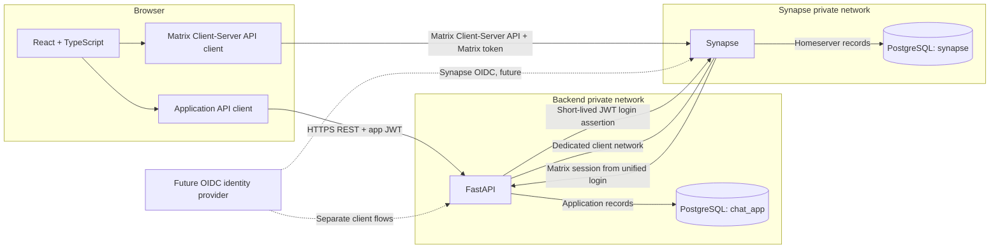

# System Architecture

## Overview

The browser is both an application client and a Matrix client. The LumaChat
React frontend uses FastAPI for application identity, profiles, and directory
search. After app-password validation, FastAPI exchanges a short-lived,
server-only JWT with Synapse and returns Synapse's Matrix session to the
browser. The frontend initializes the Matrix SDK's Rust/WASM crypto before
sync, creates encrypted rooms, sends encrypted text, and displays SDK-decrypted
events. Media uploads, encrypted attachments, and read-marker submission are
not implemented.

In deployment, browser-facing API calls go through HTTPS origins/reverse-proxy
routes. Container-only service names such as `synapse` and `postgres` are not
browser URLs. PostgreSQL remains on a private Compose network and its container
port is not published to the host.

## Responsibilities

| Component | Owns |
| --- | --- |
| React frontend | LumaChat login/registration, responsive conversation UI, demo preview, in-memory auth state, encrypted direct-room creation, encrypted text sending, decrypted Matrix timeline display, device verification, cross-signing setup, and key-backup/recovery controls. |
| Browser Matrix API client | Calls Synapse directly for room state, sync, events, encrypted room creation, encrypted text events, device/key management, backup, verification, and media downloads. File uploads and read-marker submission are not connected. |
| FastAPI | Owns app registration/login, app JWT and refresh sessions, user/profile APIs, directory visibility, configurable entitlements, and the narrow Synapse JWT login/logout exchange. |
| Synapse | Matrix users/devices; room membership/state; message delivery and history; synchronization; typing and receipt events; Matrix authentication; media repository/API; federation if explicitly enabled. |
| PostgreSQL | Separate Synapse and FastAPI containers, databases, non-superuser app roles, private networks, and persistent volumes. |
| Benchmark tooling | Planned repeatable 50-, 100-, and 500-user scenarios and reporting for latency, throughput, errors, CPU, and memory. No capacity claim is made here. |

Do not mirror Matrix messages, room state, receipts, or typing state in FastAPI
unless a future requirement explicitly needs a derived application projection.
Synapse is the source of truth for Matrix data.

## Communication and Event Flow

1. The browser sends the application username/email and password to FastAPI.
2. FastAPI validates the app password, signs a 60-second JWT with the dedicated
   FastAPI-to-Synapse key, and submits it to Synapse's JWT login flow.
3. Synapse maps the stable app-user UUID to a Matrix localpart, creates that
   Matrix account on first login, and returns its own Matrix access token.
4. The browser keeps both returned credentials in memory, verifies its Matrix
   user/device identity with Synapse, initializes the SDK Rust crypto store,
   and starts sync with the Matrix access token.
5. New direct rooms include the Matrix encryption state event at creation.
   The SDK encrypts text locally; Synapse receives and routes
   `m.room.encrypted` events. Recipient clients decrypt through Rust crypto.
6. The browser syncs events, deduplicates by Matrix event ID, and updates
   React state when the SDK decrypts an event. Plaintext rooms and unavailable
   crypto fail closed in the live composer.
7. Typing and receipt state remain Matrix-owned; this stage does not submit
   read markers or add a read-receipt interface.
8. Logout revokes the app refresh-token family and, when the browser supplies
   its Matrix access token, asks Synapse to revoke that device session.

## Authentication Boundaries

The user enters one application password. FastAPI validates it and creates a
separate short-lived JWT assertion for Synapse. The assertion uses a dedicated
key, issuer, and audience; it is never returned to the browser. Synapse issues
the Matrix access token, and the two access tokens remain valid only for their
respective APIs. Synapse registration through ordinary client requests remains
disabled. See [Authentication](authentication.md) and
[API Boundaries](api-boundaries.md).

## Database Ownership and Network

FastAPI and Synapse use separate PostgreSQL containers, databases (`chat_app`
and `synapse`), roles, networks, and persistent volumes. FastAPI's database is
reachable only over its backend-private network; the backend joins a separate
client network to reach Synapse. Neither PostgreSQL container publishes host
port `5432`. See [Database Design](database-design.md).

Separate databases and roles reduce accidental cross-access but do not provide
the same isolation as separate PostgreSQL clusters or hosts.

## Media

The browser can display supported Matrix media, but live attachment sending
is disabled. FastAPI does not proxy file bytes. Encrypted attachment handling
must use Matrix's encrypted-media workflow and is not implemented.

## Encryption and Security

For encrypted rooms, plaintext exists in the sending/receiving client process;
Synapse receives and routes the SDK-produced encrypted event payload.
Homeservers can read unencrypted room content. E2EE does not hide all metadata,
including room membership, room state not encrypted by Matrix, event timing,
and routing information. The SDK manages device keys, cross-signing,
verification, and encrypted key backup; see
[End-to-end encryption](end-to-end-encryption.md) for the implemented flow,
tests, and session/recovery limitations.

Use HTTPS outside local development, strict CORS origins, secure session
handling, least-privilege database roles, secret management outside Git,
rate-limited authentication, and audit-safe logging that omits tokens and
message bodies. Do not expose Synapse administrative APIs publicly.

## Performance Testing

Planned load scenarios live under `scripts/benchmark/scenarios/` and cover 50,
100, and 500 simulated users. A run should report message-delivery latency
(including p50/p95/p99), throughput, error rate, and sampled CPU/RAM for each
service. Reports go to the ignored `scripts/benchmark/reports/` directory.
These scenarios are architecture placeholders; no benchmark has been run and no
capacity has been established.

## References

- [Matrix Client-Server API](https://spec.matrix.org/latest/client-server-api/)
- [Authenticated Matrix media guide](https://matrix.org/docs/spec-guides/authed-media-servers/)
- [Matrix end-to-end encryption implementation guide](https://matrix.org/docs/matrix-concepts/end-to-end-encryption/)
- [Matrix JavaScript SDK documentation](https://matrix-org.github.io/matrix-js-sdk/)
- [Matrix JS SDK end-to-end encryption support](https://matrix-org.github.io/matrix-js-sdk/#end-to-end-encryption-support)
- [Synapse OpenID Connect configuration](https://element-hq.github.io/synapse/latest/openid.html)
- [Synapse PostgreSQL configuration](https://element-hq.github.io/synapse/latest/usage/configuration/config_documentation.html)
