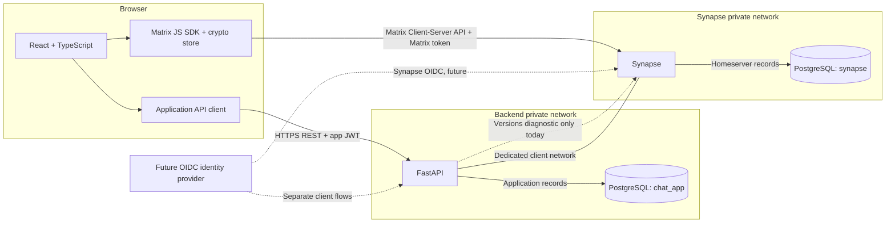

# System Architecture

## Overview

The target browser will be both an application client and a Matrix client.
React will use FastAPI for application-owned identity/profile metadata and
business rules, while the Matrix JavaScript SDK will talk directly to Synapse
for conversations and client-side encryption. The current implementation
provides the FastAPI identity/profile/access API and a narrow Synapse versions
diagnostic; the React client and Matrix messaging flows are future work.

In deployment, browser-facing API calls go through HTTPS origins/reverse-proxy
routes. Container-only service names such as `synapse` and `postgres` are not
browser URLs. PostgreSQL remains on a private Compose network and its container
port is not published to the host.

## Responsibilities

| Component | Owns |
| --- | --- |
| React frontend | Planned authentication screens, one-to-one/group chat views, message history, typing/receipt display, attachments, and encryption UX. Not implemented in this backend step. |
| Matrix JavaScript SDK (planned: `matrix-js-sdk`) | Will own Matrix login/session operations, sync, rooms/events, typing, receipts, media API calls, device keys, encryption/decryption, and encrypted attachments. |
| FastAPI | Implemented app registration/login, JWT and refresh sessions, user/profile APIs, directory visibility, configurable entitlements, health checks, and a versions-only Synapse diagnostic. Account provisioning/linking is not implemented. |
| Synapse | Matrix users/devices; room membership/state; message delivery and history; synchronization; typing and receipt events; Matrix authentication; media repository/API; federation if explicitly enabled. |
| PostgreSQL | Separate Synapse and FastAPI containers, databases, non-superuser app roles, private networks, and persistent volumes. |
| Benchmark tooling | Planned repeatable 50-, 100-, and 500-user scenarios and reporting for latency, throughput, errors, CPU, and memory. No capacity claim is made here. |

Do not mirror Matrix messages, room state, receipts, or typing state in FastAPI
unless a future requirement explicitly needs a derived application projection.
Synapse is the source of truth for Matrix data.

## Communication and Event Flow

1. The browser calls FastAPI for app authentication, profiles, directory, and
   entitlements.
2. When the Matrix client is implemented, its SDK will authenticate separately
   with Synapse and start Matrix sync.
3. The SDK will submit messages to Synapse; Synapse will persist and route
   events to other clients' sync streams.
4. Typing notifications and read receipts will use Matrix APIs, not duplicate
   FastAPI state.
5. The current FastAPI integration calls only Synapse's versions endpoint. It
   does not proxy ordinary client Matrix traffic.

## Authentication Boundaries

The current prototype uses app-owned username/email and password authentication
for FastAPI. Matrix login is not integrated. A future SSO design may use an OIDC
identity provider with separate FastAPI and Synapse client/audience flows; the
identity-provider `iss` and stable `sub` claims can then provide an explicit
account-link key.

An application JWT is not a Matrix access token and is never sent to Synapse.
A Synapse admin credential, if needed for provisioning, stays server-side and
must not be sent to the browser. See [Authentication](authentication.md) and
[API Boundaries](api-boundaries.md).

## Database Ownership and Network

FastAPI and Synapse use separate PostgreSQL containers, databases (`chat_app`
and `synapse`), roles, networks, and persistent volumes. FastAPI's database is
reachable only over its backend-private network; the backend joins a separate
client network to reach Synapse. Neither PostgreSQL container publishes host
port `5432`. See [Database Design](database-design.md).

Separate databases and roles reduce accidental cross-access but do not provide
the same isolation as separate PostgreSQL clusters or hosts.

## Media

The browser SDK uploads Matrix attachments to Synapse's media API and puts the
resulting Matrix content URI in the room event. For encrypted rooms, the
supported SDK encrypts attachment bytes client-side and carries the required
decryption metadata in the encrypted event. FastAPI should not proxy file bytes
by default; it may enforce application-specific authorization or quotas on its
own endpoints. Enforce upload-size limits at the homeserver/proxy and any app
upload endpoint. Browser downloads must use the SDK's supported authenticated
media flow when the homeserver requires authorization; do not assume an `mxc:`
URI can be used as an unauthenticated image URL.

## Encryption and Security

For encrypted rooms, plaintext exists in the sending/receiving client process;
Synapse stores and routes encrypted event payloads. In unencrypted rooms,
homeservers can read message content. E2EE does not hide all metadata, including
room membership, event timing, and routing information. Encryption is a planned
client capability, not implemented or verified in this repository.

Use HTTPS outside local development, strict CORS origins, secure session
handling, least-privilege database roles, secret management outside Git,
rate-limited authentication, and audit-safe logging that omits tokens and
message bodies. Do not expose Synapse administrative APIs publicly.

## Performance Testing

Planned load scenarios live under `scripts/benchmark/scenarios/` and cover 50,
100, and 500 simulated users. A run should report message-delivery latency
(including p50/p95/p99), throughput, error rate, and sampled CPU/RAM for each
service. Reports go to the ignored `scripts/benchmark/reports/` directory.
These scenarios are architecture placeholders; no benchmark has been run and no
capacity has been established.

## References

- [Matrix Client-Server API](https://spec.matrix.org/latest/client-server-api/)
- [Authenticated Matrix media guide](https://matrix.org/docs/spec-guides/authed-media-servers/)
- [Matrix end-to-end encryption implementation guide](https://matrix.org/docs/matrix-concepts/end-to-end-encryption/)
- [Matrix JavaScript SDK documentation](https://matrix-org.github.io/matrix-js-sdk/)
- [Matrix JS SDK end-to-end encryption support](https://matrix-org.github.io/matrix-js-sdk/#end-to-end-encryption-support)
- [Synapse OpenID Connect configuration](https://element-hq.github.io/synapse/latest/openid.html)
- [Synapse PostgreSQL configuration](https://element-hq.github.io/synapse/latest/usage/configuration/config_documentation.html)
